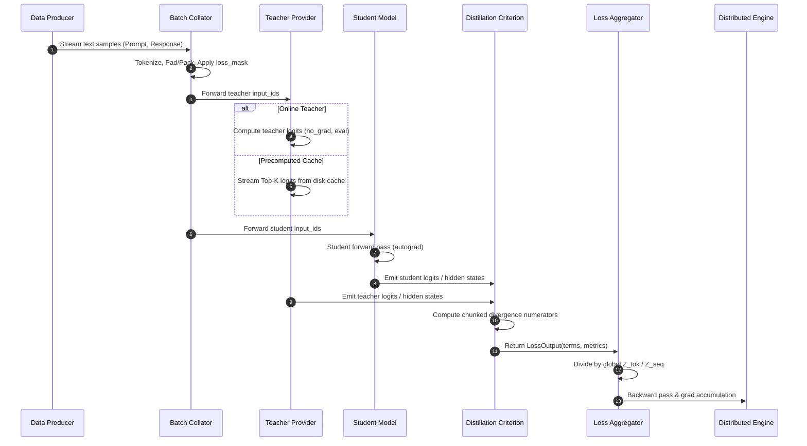

# Data Flow & Teacher Caching

This document explains the runtime lifecycle of training data in LM-KD, from raw text ingestion to gradient accumulation, as well as the offline teacher caching subsystem.

---

## 1. End-to-End Training Data Flow



---

## 2. Sequence Packing & Zero-Padding Efficiency

In standard padding, short sequences in a batch are padded with zeros to match the longest sequence. For multi-turn chats or instruction datasets with high sequence length variance, up to **60% of GPU compute is wasted on padding tokens**.

LM-KD implements **attention-isolated sequence packing**:
- Multiple short sequences are concatenated end-to-end into a single contiguous context of length $L_{\max}$ (e.g., 4096 or 8192).
- FlashAttention-2 cumulative sequence length markers (`cu_seqlens`) prevent attention leakage across sequence boundaries.
- Packing is enabled with a single configuration flag:
  ```yaml
  data:
    packing: true
    max_length: 4096
  ```

---

## 3. Lazy Logit Chunking: Preventing Large-Vocab OOMs

Modern LLM vocabularies ($V > 150,000$) make materializing full $[B, S, V]$ tensors during forward/backward passes prohibitively expensive.

LM-KD solves this through **target-aligned lazy chunked logit views** ([`src/lmkd/models/logits_view.py`](../../src/lmkd/models/logits_view.py) and [`src/lmkd/models/chunked_head.py`](../../src/lmkd/models/chunked_head.py)):
1. Student hidden representations are projected to logits in chunks of sequence length $C$ (e.g., $C = 512$) via `ChunkedHead`.
2. Divergence terms (such as $\sum P_T \log \frac{P_T}{P_S}$) are accumulated incrementally.
3. The intermediate logit chunk is discarded immediately, preserving GPU VRAM.

```python
# Evaluates KL divergence chunk-by-chunk via LogitsView without full [B, S, V] VRAM allocation
logits_view = student_output.logits  # LogitsView
loss = logits_view.chunked_divergence(
    teacher_logits=teacher_output.logits,
    divergence_fn=forward_kl,
    chunk_size=512,
    temperature=1.0
)
```

---

## 4. Offline Teacher Caching Pipeline

For static instruction corpora, running teacher inference repeatedly at every epoch or step wastes immense compute. LM-KD provides an offline pipeline to precompute and cache teacher representations to disk.

### Generating the Teacher Cache: `lmkd pipeline`
Create a pipeline configuration (`cache_pipeline.yaml`):
```yaml
pipeline:
  - name: teacher_cache
    type: teacher_cache
    teacher:
      path: Qwen/Qwen2.5-14B-Instruct
      dtype: bf16
    data:
      path: databricks/databricks-dolly-15k
      split: train
    cache:
      output_dir: ./caches/dolly_qwen14b
      format: safetensors
      top_k: 256
```

Execute the pipeline:
```bash
lmkd pipeline -c cache_pipeline.yaml
```

### Consuming the Cache in Distillation
Update your recipe to read from the precomputed cache:
```yaml
teacher:
  provider: precomputed_cache
  cache_dir: ./caches/dolly_qwen14b
```
When running with cached teacher signals, training speed increases by **3.5x to 8x**, and GPU memory required for the teacher model is reduced to zero.

