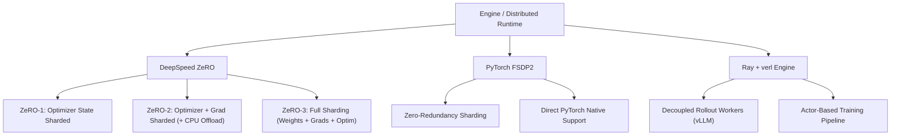
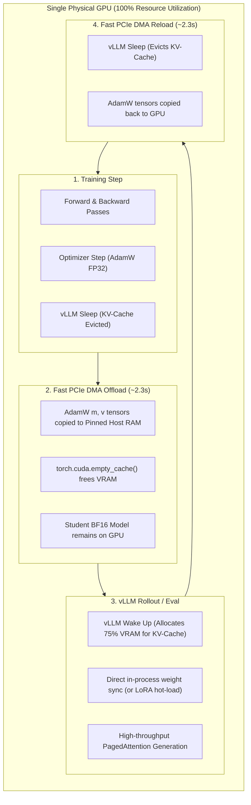

# Distributed Backends & Parallelism

Scaling LLM knowledge distillation across high-performance multi-GPU clusters requires careful orchestration of distributed strategies, memory partitioning, and exact token normalization.

LM-KD natively supports **DeepSpeed ZeRO**, **PyTorch FSDP2**, and **Ray-decoupled rollouts**.

---

## 1. Supported Distributed Backends



### DeepSpeed ZeRO-1, 2, and 3
LM-KD integrates DeepSpeed through standardized engine templates in [`recipes/_base_/deepspeed/`](../../recipes/_base_/deepspeed/):
- **ZeRO-1:** Partitions optimizer states. Ideal when student and teacher comfortably fit in GPU memory.
- **ZeRO-2 + Offload:** Partitions optimizer states and gradients, optionally offloading optimizer states to host RAM. Recommended for distilling 7B–14B models on consumer GPUs.
- **ZeRO-3:** Fully shards student parameters, gradients, and optimizer states across all ranks. Enables training models up to 70B+ parameters.

Example configuration in recipe (layering ZeRO-2 presets):
```yaml
_base_:
  - ../_base_/engine_zero2.yaml

train:
  batch_size: 64
  micro_batch_size: 4
  output_dir: outputs/my_zero2_run
```

Launch with the multi-GPU launcher script:
```bash
NUM_GPUS=4 bash scripts/train_multigpu_deepspeed.sh recipes/same_tokenizer/fkl.yaml \
    --set train.batch_size=64 train.micro_batch_size=4
```

### PyTorch FSDP2 (Fully Sharded Data Parallel)
Native PyTorch distributed backend providing efficient forward/backward parameter prefetching and integration with PyTorch 2.x compilation (`torch.compile`).

---

## 2. Global Token Normalization (`num_items_in_batch`)

A common flaw in distributed LLM training implementations is **naive micro-batch loss averaging**.

### The Problem with Naive Averaging
In causal language modeling, different micro-batches contain different numbers of valid (non-padded, supervised) response tokens. If micro-batch 1 has 1,200 tokens and micro-batch 2 has 300 tokens:
$$\text{Naive Mean} = \frac{1}{2} \left( \frac{\sum_{t \in B_1} \ell_t}{1200} + \frac{\sum_{t \in B_2} \ell_t}{300} \right)$$
In this scenario, tokens in $B_2$ are artificially weighted **4 times more** than tokens in $B_1$, distorting the true gradient of the dataset distribution.

### The LM-KD Solution: Centralized Global Normalization
LM-KD strictly computes:
1. Each micro-batch computes the **sum** of loss numerators: $S_m = \sum_{i \in B_m} \ell_i$.
2. The number of valid supervised tokens $N_m$ in the micro-batch is counted.
3. Before the optimizer step, an `all_reduce` gathers the total valid tokens across all micro-batches and GPU ranks:
   $$Z_{\text{tok}} = \sum_{\text{rank}=1}^R \sum_{m=1}^M N_{m, \text{rank}}$$
4. The global gradient update is normalized exactly:
   $$\mathcal{L}_{\text{global}} = \frac{1}{Z_{\text{tok}}} \sum_{\text{rank}=1}^R \sum_{m=1}^M S_{m, \text{rank}}$$

This ensures that gradient updates are **numerically identical** regardless of batch size per GPU, gradient accumulation steps, or rank count.

---

## 3. Decoupled Rollout with Ray & vLLM

For large multi-GPU clusters, on-policy algorithms (such as OPSD, GKD, and SPIN) can utilize a **decoupled rollout architecture**:
1. **Training Cluster:** Runs DeepSpeed ZeRO-2 or FSDP across training GPUs, computing backward passes.
2. **Rollout Cluster:** Runs high-throughput vLLM instances dedicated entirely to generation with optimized PagedAttention KV-caches (`rollout: {type: vllm_server}`).
3. **Weight Sync:** After $K$ optimizer steps, student weights are broadcast asynchronously to the vLLM engine via NCCL (`lmkd.rollout.vllm_server`).

> [!NOTE]
> While decoupled server architectures eliminate local memory contention, they introduce **GPU idle bubbles** if cluster scheduling is alternating (trainer sits idle while server generates, and vice-versa).

---

## 4. Single-GPU Colocate + Asynchronous Optimizer Offloading

For single-node or budget-constrained setups (1–2 GPUs per node), dedicating an entire GPU strictly to a vLLM server is wasteful. LM-KD implements a **Single-GPU Colocate + Optimizer Offload architecture** ([`train/optimizer_offload.py`](../../src/lmkd/train/optimizer_offload.py)):



### Key Technical Mechanisms
1. **Persistent Pinned Buffers:** CPU host buffers are pre-allocated with `pin_memory=True` once and reused across all epochs/steps, completely eliminating memory allocation overhead.
2. **Selective Offloading:** Only heavy FP32 optimizer states ($m, v$, taking ~75% of trainer VRAM) and master weights are offloaded. Low-precision model parameters (BF16) remain on the GPU, allowing vLLM to sync weights directly in-process via pointers without host roundtrips.
3. **PCIe Bandwidth Efficiency:** Over PCIe 4.0 x16 (~24 GB/s), a 56 GB AdamW state (for a 7B model) transfers in **~2.33 seconds**, representing **$< 0.3\%$** overhead over a 30-minute training epoch while liberating 70–80% VRAM for vLLM generation.

### Enabling in Recipes
```yaml
rollout:
  type: vllm_colocate
  gpu_memory_utilization: 0.75   # Up to 75% VRAM dedicated to vLLM
  enable_sleep_mode: true
  offload_optimizer: true        # Automatic DMA offload/reload
```


