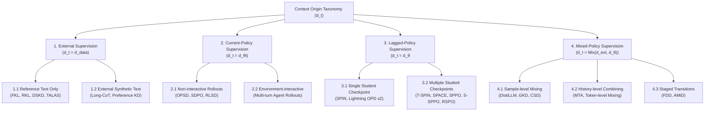

# Taxonomy of LLM Knowledge Distillation

A central insight of the LM-KD framework is that **the effectiveness of knowledge distillation in language models is governed fundamentally by the origin of the training context**. Knowing which teacher model is used and which divergence loss is computed does not specify *under which prefix contexts* the student is trained.

In an autoregressive model every token is predicted from a prefix, and the teacher's signal can be applied to prefixes taken from a reference corpus, from an external model's answers, or from sequences generated by the student itself. Knowing the teacher or the loss does not tell you which contexts the student actually learns on, so the taxonomy classifies each training configuration by the **origin and version of its training context**.

This document formalizes the **Context Origin Taxonomy** and the **6 Orthogonal Axes of Distillation Architecture**.

---

## 1. The Context Origin Taxonomy

In autoregressive language models, predicting token $y_j$ depends on the prefix state $s = (x, y_{<j})$, where $x$ is the prompt and $y_{<j}$ is the preceding sequence. The context distribution $d_t$ defines how prefix states are gathered during training step $t$:

```text
Taxonomy by Training Context Source
├── 1. External Supervision
│   ├── 1.1. Reference text only
│   │   ├── 1.1.1. Autoregressive generation on reference prefixes
│   │   └── 1.1.2. Text embedding and dense retrieval
│   └── 1.2. Text generated by external models
├── 2. Current-policy Supervision
│   ├── 2.1. Non-interactive rollouts
│   └── 2.2. Environment-interactive rollouts
├── 3. Lagged-policy Supervision
│   ├── 3.1. Data from a single student checkpoint
│   └── 3.2. Data from multiple student checkpoints
└── 4. Mixed-policy Supervision
    ├── 4.1. Mixing samples across sources
    ├── 4.2. Combining sources within the generation history
    └── 4.3. Staged source transitions
```



---

## 2. The 4 Context Origin Branches

### Branch 1: External Supervision ($d_t = d_{\text{data}}$)
- **Definition:** The context prefixes $s = (x, y_{<j})$ are drawn entirely from a static reference corpus or text generated by external models prior to or independently of student rollouts.
- **Sub-branches:**
  - **1.1. Reference text only:**
    - *1.1.1. Autoregressive generation on reference prefixes:* Standard logit KD and cross-tokenizer transfer conditioned on human demonstration text.
    - *1.1.2. Text embedding and dense retrieval:* Representation compression for bi-encoders and semantic matching.
  - **1.2. Text generated by external models:** Offline teacher synthetic reasoning traces, long-CoT chains, or external preference pairs.
- **Characteristics:**
  - Highly parallelizable and amenable to offline caching (precomputing teacher logits $\tau_T(s)$ to disk, yielding 3.5x to 8x throughput increases).
  - Susceptible to **exposure bias / distribution shift**: because the student never encounters its own generation mistakes during training, small errors at inference time snowball into hallucinations and unrecoverable degeneration.
- **Representative Methods:**
  - *Same-tokenizer logit KD:* FKL, RKL, JSD, TVD, SFKL, SRKL
  - *Cross-tokenizer KD:* DSKD, DSKDv2, DSKD-CMA, DSKDv2-ETA, ULD, MinED, MultiLevelOT, E-SCOT, ALM, SRA, MCW-KD, ResidualKD
  - *Long-CoT reasoning:* SSFT, P-ALIGN, SGL-Spectral
  - *Preference distillation:* VPD (PAD), PPD, DCKD, TVKD, ADPA, CTPD, DP3O, PBSD
  - *Embedding distillation:* TALAS, DistillCSE, EMO, Jasper, MoL

### Branch 2: Current-Policy Supervision ($d_t = d_{\theta_t}$)
- **Definition:** Context prefixes are sampled autoregressively on-the-fly from the student's *current parameter state* $\theta_t$: $y \sim P_{\theta_t}(\cdot \mid x)$, and parameter updates are applied directly to that same version.
- **Sub-branches:**
  - **2.1. Non-interactive rollouts:** Student starts from a given prompt and generates its own response trajectory without receiving intermediate environment observations (e.g., self-distillation on math reasoning).
  - **2.2. Environment-interactive rollouts:** Student executes actions, receives dynamic observations from an environment, and conditions subsequent steps on those observations (multi-turn agentic KD).
- **Characteristics:**
  - Directly addresses exposure bias via interactive imitation learning principles (DAgger).
  - The student learns how the teacher or verifier guides recovery from mistakes that the student itself generates.
  - Requires tight coupling between an inference generation engine (e.g., colocated or server-mode vLLM) and the gradient training engine.
- **Representative Methods:**
  - *On-policy self-distillation:* OPSD, SDPO, RLSD
  - *Imitation & online policy distillation:* Pure on-policy GKD ($\lambda = 1$), OPD

### Branch 3: Lagged-Policy Supervision ($d_t = d_{\theta_{<t}}$)
- **Definition:** Contexts are generated by student rollouts, but the data is used *after* the student's parameters have changed ($\theta_t \neq \theta_{\text{gen}}$). The student learns on its own generations produced by earlier checkpoint versions ($\theta_{t-1}, \theta_0, \dots$) or asynchronous rollout workers.
- **Sub-branches:**
  - **3.1. Data from a single student checkpoint:** Rollouts collected from a fixed student checkpoint and optimized over an entire round or multiple optimizer steps (e.g., iterative SPIN where iteration $t$ optimizes over responses generated once by checkpoint $M_{t-1}$; Lightning OPD stage 2).
  - **3.2. Data from multiple student checkpoints:** Contexts originating from two or more historical checkpoints or opponent pools (e.g., T-SPIN anchoring to base prototype $\theta_0$ and previous iteration $\theta_{t-1}$; SPPO, S-SPPO, RSPO maintaining historical checkpoint opponent populations; Near-Policy distillation, f-OPD with freshness weighting).
- **Characteristics:**
  - Amortizes expensive rollout generation overhead across multiple gradient update steps or iterative rounds, dramatically increasing GPU training throughput.
  - Decouples rollout generation from synchronous backpropagation lockstep.
  - Requires policy drift mitigation (e.g., reference model anchors, soft win-rate regression targets, or importance sampling corrections) to prevent divergence as $\theta_t$ drifts away from $\theta_{<t}$.
- **Representative Methods:**
  - *Self-play fine-tuning:* SPIN, T-SPIN, SPACE, SPPO, S-SPPO, RSPO
  - *Other surveyed methods:* Lightning OPD (stage 2), Near-Policy Distillation, f-OPD

### Branch 4: Mixed-Policy Supervision ($`d_t = \text{Mix}(d_{\text{ext}}, d_{\theta})`$)
- **Definition:** Contexts are gathered by dynamically combining external reference demonstrations (or external teacher text) with student rollouts (on-policy or lagged/replay).
- **Sub-branches:**
  - **4.1. Mixing samples across sources:** Within a training phase, different samples or batches are drawn from different sources (e.g., **DistiLLM** via Adaptive SGO combining reference data, student rollouts, and replay buffer; **GKD** with mixture weight $\lambda \in (0, 1)$; **CSD** with mixed student/reference batches).
  - **4.2. Combining sources within the generation history:** Within a single sequence trajectory, tokens are drawn from both external sources and student generation (e.g., **MTA** / Multi-Granular Trajectory Alignment matching prefix/phrase segments across layer hierarchies; MiniLLM token-level policy mixing; teacher-prefill trajectories).
  - **4.3. Staged source transitions:** Training transitions between distinct source regimes across curriculum phases (e.g., **FDD**, **AMiD** with staged α-mixture assistant distributions; Qwen3 pretrain-to-rollout stages).
- **Characteristics:**
  - Combines the high sample efficiency and semantic grounding of ground-truth reference data with the error-correction capabilities of student rollouts.
  - Mitigates exposure bias while guarding against policy collapse from ungrounded student hallucinations.
  - **Note on DistiLLM:** DistiLLM dynamically coordinates reference ground-truth data with student rollouts through Adaptive SGO (`AdaptiveSGOProducer`: Ground Truth vs. Student Rollout vs. Replay Buffer). The presence of a replay buffer is an internal mechanism of its mixed sampling strategy, not an isolated student-only setup. Because external reference text and student rollouts are continuously mixed during training, DistiLLM belongs to Branch 4 (Mixed-Policy Supervision, 4.1).
- **Representative Methods:**
  - CSD, DistiLLM, GKD, FDD, AMiD, MTA

---

## 3. Master Mapping Table & Classification Principles

| Branch | Training context comes from | Methods in LM-KD |
| :--- | :--- | :--- |
| **1. External Supervision** | A reference corpus or text written by external models; no student rollouts | **Same-tokenizer logit KD:** FKL, RKL, JSD, TVD, SFKL, SRKL<br>**Cross-tokenizer KD:** DSKD, DSKDv2, DSKD-CMA, DSKDv2-ETA, ULD, MinED, MultiLevelOT, E-SCOT, ALM, SRA, MCW-KD, ResidualKD<br>**Long-CoT reasoning:** SSFT, P-ALIGN, SGL-Spectral<br>**Preference distillation:** VPD (PAD), PPD, DCKD, TVKD, ADPA, CTPD, DP3O, PBSD<br>**Embedding distillation:** TALAS, DistillCSE, EMO, Jasper, MoL |
| **2. Current-policy Supervision** | Rollouts generated by the exact student version that is about to be updated | **On-policy self-distillation:** OPSD, SDPO, RLSD |
| **3. Lagged-policy Supervision** | Student-generated data that is used after the student's parameters have changed | **Self-play fine-tuning:** SPIN, T-SPIN, SPACE, SPPO, S-SPPO, RSPO |
| **4. Mixed-policy Supervision** | External text combined with student rollouts | CSD, DistiLLM, GKD, FDD, AMiD, MTA |

> **Classification unit.** The taxonomy classifies a concrete *training configuration*, not an algorithm name. The same method can fall into different branches depending on how it is run (for example, GKD can be external, current-policy or mixed depending on its mixing ratio $\lambda$). The table lists each method under the branch of the configuration evaluated in LM-KD.
>
> The taxonomy answers *"which contexts does the student learn on?"*, not *"which loss is optimized?"*. Methods with very different losses can share a branch, and one family can span several branches (for example, the same-tokenizer methods are split between External and Mixed). MTA is classified under Mixed, including when it is combined with a cross-tokenizer base method. Method families remain the unit of documentation: formulations, pseudocode and recipes are grouped by family in the [Methods Catalog](../methods/index.md).

---

## 4. The 6 Orthogonal Axes of LM-KD

To translate this taxonomy into a composable engineering toolkit, LM-KD decomposes any knowledge distillation algorithm into 6 independent, orthogonal axes:

```text
┌────────────────────────────────────────────────────────────────────────┐
│                        6-AXIS LM-KD DECOMPOSITION                      │
├───────────────────┬────────────────────────────────────────────────────┤
│ Axis A: Context   │ Source of prefixes (External, Current, Lagged,     │
│                   │ Mixed schedule)                                    │
├───────────────────┼────────────────────────────────────────────────────┤
│ Axis B: Producer  │ Batch collation, sequence packing, multi-turn,     │
│                   │ preference pairs, cross-tokenizer token aligners   │
├───────────────────┼────────────────────────────────────────────────────┤
│ Axis C: Teacher   │ Provider backend (local HF, vLLM, remote API,      │
│                   │ EMA checkpoint, offline cache) & signal extractor  │
├───────────────────┼────────────────────────────────────────────────────┤
│ Axis D: Criterion │ Mathematical divergence (FKL, RKL, JSD, TVD, CSD,  │
│                   │ Sinkhorn, Ranking Loss, DPO-style alignment)       │
├───────────────────┼────────────────────────────────────────────────────┤
│ Axis E: Step      │ Execution strategy: standard backprop, PPO/GRPO,   │
│                   │ dual-model sync, gradient surgery/hooks            │
├───────────────────┼────────────────────────────────────────────────────┤
│ Axis F: Optimizer │ Parameter updates: AdamW, Muon, TALAS, SAM,        │
│                   │ schedules, gradient clipping                       │
└───────────────────┴────────────────────────────────────────────────────┘
```

This decomposition ensures that **any axis can be altered independently without rewriting the others**:
- Changing the loss from Forward KL to Reverse KL is a 1-line change in **Axis D**.
- Switching from a single local teacher to an API teacher is an isolated change in **Axis C**.
- Transitioning from offline external supervision to on-policy vLLM rollouts is an isolated change in **Axis A/B**.
- Distilling across different tokenizers is achieved by inserting a token aligner into **Axis B** and an alignment loss into **Axis D**.
