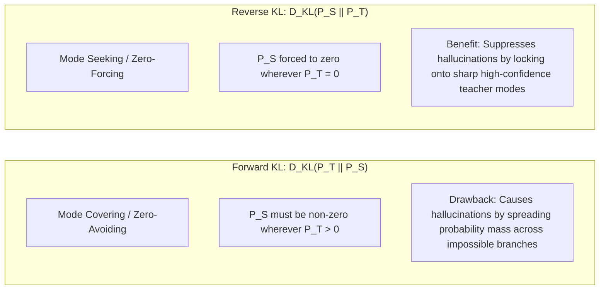

# Theoretical Foundations & Divergence Analysis

Knowledge distillation in large language models optimizes the student parameters $\theta$ so that the student policy $P_\theta$ approximates the teacher distribution $P_T$. This document details the mathematical underpinnings, divergence properties, and gradient dynamics that govern different distillation criteria.

---

## 1. Predictive Distribution & Temperature Scaling

For an autoregressive model conditioned on prefix state $s = (x, y_{<j})$, the next-token probability distribution over vocabulary $\mathcal{V}$ is parameterized via logits $z$:

$$P_\theta(y_j = v \mid s) = \frac{\exp\left(z_S(v) / T\right)}{\sum_{u \in \mathcal{V}} \exp\left(z_S(u) / T\right)}$$

Where $T > 0$ denotes the distillation temperature. Higher temperatures ($T > 1$) soften the distribution, exposing dark knowledge (relative probabilities among non-argmax tokens), while $T \to 0$ collapses the distribution into a one-hot argmax.

---

## 2. Forward KL vs. Reverse KL: Mode Covering vs. Mode Seeking

The choice of statistical divergence fundamentally alters student behavior, especially under model capacity constraints ($|\theta| \ll |\theta_T|$).

### Forward KL Divergence (FKL)
$$\mathcal{L}_{\text{FKL}}(\theta; s) = D_{\text{KL}}(P_T(\cdot \mid s) \parallel P_\theta(\cdot \mid s)) = \sum_{v \in \mathcal{V}} P_T(v \mid s) \log \frac{P_T(v \mid s)}{P_\theta(v \mid s)}$$

- **Zero-Avoiding Property:** If $P_T(v \mid s) > 0$, then $P_\theta(v \mid s)$ cannot be $0$, otherwise $D_{\text{KL}} \to \infty$. Consequently, the student tries to cover every possible mode of the teacher.
- **The Hallucination Dilemma:** Because the student possesses lower capacity than the teacher, stretching its capacity across all modes inflates variance, allocating probability mass to low-likelihood tokens and inducing hallucinations during inference.

### Reverse KL Divergence (RKL)
$$\mathcal{L}_{\text{RKL}}(\theta; s) = D_{\text{KL}}(P_\theta(\cdot \mid s) \parallel P_T(\cdot \mid s)) = \sum_{v \in \mathcal{V}} P_\theta(v \mid s) \log \frac{P_\theta(v \mid s)}{P_T(v \mid s)}$$

- **Zero-Forcing Property:** If $P_T(v \mid s) \to 0$, the student is heavily penalized if $P_\theta(v \mid s) > 0$. The objective forces $P_\theta(v \mid s) \to 0$.
- **Mode Focusing:** The student chooses the single dominant mode of the teacher and concentrates its probability mass there, producing sharp, confident, and hallucination-free generations.

---

## 3. Logit-Shift Invariance & Concrete Score Distillation (CSD)

When optimizing student policies against a teacher distribution, practitioners encounter a fundamental tradeoff between softmax-based probability matching and direct logit matching:

1. **The Softmax Smoothing Bottleneck:** Standard probability-matching divergences (Forward KL, Reverse KL) apply a Softmax transformation before computing distances. Softmax blurs fine-grained logit details and discards valuable uncertainty and relative distance information across non-argmax tokens.
2. **Direct Logit Distillation & Shift Invariance:** Directly minimizing the Mean Squared Error (MSE) between teacher logits $z_T$ and student logits $z_S$ preserves logit details, but violates **logit shift invariance**: adding any constant $c \in \mathbb{R}$ to all logits ($z' = z + c \cdot \mathbf{1}$) leaves the resulting probability distribution completely unchanged:
   $$\text{Softmax}(z + c \cdot \mathbf{1}) \equiv \text{Softmax}(z)$$
   Forcing $z_S \approx z_T$ via MSE artificially restricts the student's solution space to exact numerical values rather than preserving relative distributional shapes.

**Concrete Score Distillation (CSD)** (*Distillation of Large Language Models via Concrete Score Matching*, Kim et al., ICLR 2026) resolves this by matching the discrete "concrete score"—the matrix of pairwise logit residuals between vocabulary tokens:

$$S(z)_{uv} = z(u) - z(v)$$

$$\mathcal{L}_{\text{CSD}}(\theta) = \sum_{j=1}^L \sum_{u, v \in \mathcal{V}} w(u, v) \left( [z_S(u \mid s_j) - z_S(v \mid s_j)] - [z_T(u \mid s_j) - z_T(v \mid s_j)] \right)^2$$

Because $[(z(u) + c) - (z(v) + c)] \equiv z(u) - z(v)$, CSD is strictly invariant under arbitrary scalar logit shifts, capturing the teacher's exact ranking geometry while granting the student full numerical representation flexibility. By selecting the weighting function $w(u, v)$, CSD can smoothly interpolate between **mode-seeking** and **mode-covering** dynamics without numerical instability.

---

## 4. Cross-Tokenizer Divergences & Optimal Transport

When the student and teacher use different tokenizers ($|\mathcal{V}_S| \neq |\mathcal{V}_T|$), token indices do not match, rendering standard cross-entropy and KL divergences undefined.

LM-KD implements three theoretical solutions for cross-tokenizer transfer:

### 1. Dual-Space Projection (DSKD & DSKDv2)
Student hidden representations $h_S \in \mathbb{R}^{d_S}$ and teacher hidden representations $h_T \in \mathbb{R}^{d_T}$ are mapped into a shared latent space via parameterized linear projectors:
$$\mathcal{L}_{\text{rep}} = 1 - \cos\left( W_S h_S,\, W_T h_T \right)$$
DSKDv2 extends this by computing dynamic subword-to-token importance weights based on token entropy.

### 2. Optimal Transport & Sinkhorn Divergence (MLOT)
Rather than assuming rigid alignment between tokens, cross-tokenizer alignment is framed as an Optimal Transport problem between probability distributions over sequence tokens:

$$\mathcal{W}_c(\mu_S, \mu_T) = \min_{P \in \Pi(\mu_S, \mu_T)} \sum_{i=1}^{L_S} \sum_{j=1}^{L_T} P_{ij} C_{ij} - \lambda H(P)$$

Where $C_{ij} = 1 - \frac{h_S(i)^\top h_T(j)}{\|h_S(i)\| \|h_T(j)\|}$ is the cost matrix and $H(P)$ is the entropy regularizer solved efficiently via the Sinkhorn-Knopp algorithm.

---

## 5. Summary Comparison of Divergence Criteria

| Divergence Criterion | Objective $\ell(P_\theta, P_T)$ | Alignment Type | Mode Property | Gradient Variance |
| :--- | :--- | :--- | :--- | :--- |
| **Forward KL (FKL)** | $P_T \log(P_T / P_\theta)$ | Same-Vocab | Mode-Covering | Very Low |
| **Reverse KL (RKL)** | $P_\theta \log(P_\theta / P_T)$ | Same-Vocab | Mode-Seeking | Medium |
| **Jensen-Shannon (JSD)**| $\frac{1}{2} D_{\text{KL}}(P_T \parallel M) + \frac{1}{2} D_{\text{KL}}(P_S \parallel M)$ | Same-Vocab | Balanced | Low |
| **Concrete Score (CSD)** | Pairwise logit difference MSE $\Delta z$ | Same-Vocab | Configurable (Mode-Seeking/Covering) | Low (Shift-Invariant) |
| **Optimal Transport (MLOT)**| Sinkhorn Wasserstein distance | Cross-Vocab | Geometric | Medium |
| **Dual-Space (DSKDv2)** | Cosine projection + Soft Mapping | Cross-Vocab | Feature-Matching | Low |

