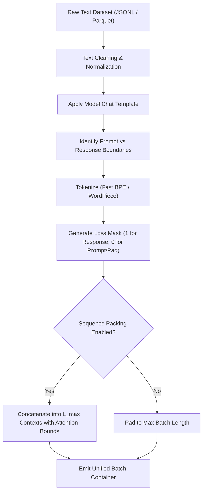

# Preprocessing & Synthetic Data Pipelines

This document covers how raw textual data is converted into training tensors, and how synthetic datasets are generated from teacher models.

---

## 1. The Tokenization & Packing DAG



### Loss Masking Protocol
To prevent the student from penalizing itself for predicting user prompts, LM-KD automatically computes `seq.loss_mask`:
- Tokens corresponding to system instructions, user prompts, and conversation metadata are masked with `0`.
- Tokens generated in the assistant response are labeled with `1`.
- Padding tokens are labeled with `0` and assigned target `-100`.

---

## 2. Generating Synthetic Datasets from Teacher Models

When high-quality human demonstrations are scarce or expensive, synthetic rollouts from frontier teacher models (e.g., DeepSeek-R1, Qwen2.5-72B-Instruct) are generated and filtered using LM-KD's offline pipeline stages (`generate`, `verify_filter`):

```yaml
# configs/synthetic_generation_pipeline.yaml
pipeline:
  - stage: generate
    model: Qwen/Qwen2.5-72B-Instruct
    engine: vllm
    sampling:
      temperature: 0.7
      top_p: 0.95
      max_new_tokens: 2048
    n: 4
    chat_template: true
  - stage: verify_filter
    grader: math_verify
    pred_field: output
    gold_field: answer
    keep_unverified: false
```

Execute the offline generation pipeline with the CLI:

```bash
lmkd pipeline -c configs/synthetic_generation_pipeline.yaml --shard 0/1
```

### Quality Filtering & Execution Verification
Synthetic data generation supports automated filtering hooks via `verify_filter`:
- **Math Verifier (`math_verify` / `boxed_builtin`):** Executes symbolic answer verification against ground-truth expressions using SymPy and LaTeX normalizers.
- **Multiple Choice Grader (`mcq`):** Automatically extracts target answer options (A–D) and matches against canonical references.
- **Reward Model Thresholding / Scoring (`score`):** Retains only generations exceeding a calibrated minimum reward score.

