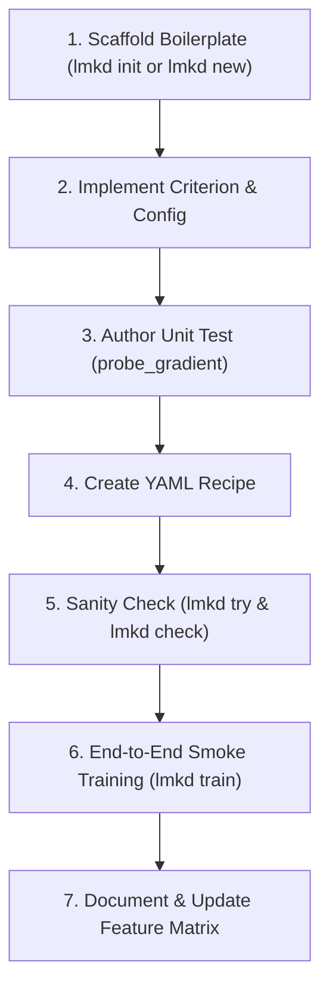

# How-To: Adding a New Baseline

This guide walks through the exact workflow required to implement, test, and register a new knowledge distillation baseline in LM-KD.

---

## The Complete Baseline Checklist

Follow this 7-step checklist whenever contributing a new method:



---

## Step 1: Scaffold Boilerplate with `lmkd init` or `lmkd new`

LM-KD supports two scaffolding workflows depending on the scope of your contribution:

### Option A: Full Multi-Axis Baseline Package (`lmkd init`)

If you are building a full baseline paper that customizes multiple axes (loss, data producer/aligner, teacher input/provider, training loop, or evaluation) while keeping framework defaults for anything you don't touch, use `lmkd init`:

```bash
# Target the official baselines directory: src/baselines/<domain>/<name>/
lmkd init my_method --baseline --domain same_tokenizer

# Or target local scratch development in dev/<name>/
lmkd init my_method --dev
```

This creates a complete modular package containing:
- `__init__.py`: Auto-loads and registers all package plugins on import.
- `config.py`: Centralized Pydantic hyperparameter schema.
- `loss.py`: Criterion definition (inheriting from `Criterion` or `NLL`).
- `data.py`: Custom transforms, aligners, or batch producers.
- `teacher.py`: Teacher input builders and provider policies.
- `train.py`: Custom step strategies, algorithms, or callbacks.
- `eval.py`: Custom evaluators and pure metrics.
- `recipe.yaml`: Executable training configuration.
- `tests/unit/test_my_method.py`: Generated test template.

See the full end-to-end tutorial: **[Building a New Method with `lmkd init` (MTA + DistiLLM Adaptive Off-Policy + Privileged Teacher)](../tutorials/building-a-method-with-lmkd-init.md)**.

### Option B: Single Standalone Plugin (`lmkd new`)

Alternatively, to scaffold a single standalone criterion plugin:

```bash
# Example: Adding a new divergence called "alpha_div" in the same_tokenizer domain
lmkd new criterion alpha_div --domain same_tokenizer
```

This automatically generates:
- `src/lmkd/losses/alpha_div.py`: Criterion plugin template.
- `tests/unit/test_alpha_div.py`: Unit test with registry checks and gradient probe.
- `recipes/same_tokenizer/alpha_div.yaml`: Standalone runnable recipe (defaults to `recipes/experimental/` if `--domain` is omitted).

---

## Step 2: Implement the Criterion

Edit `src/lmkd/losses/alpha_div.py` (or `src/baselines/<domain>/<name>/loss.py`). Inherit from [`Criterion`](../../src/lmkd/losses/base.py) and define your Pydantic `Config`:

```python
from __future__ import annotations

from typing import ClassVar
import torch
import torch.nn.functional as F

from lmkd.core.plugin import BaseConfig
from lmkd.core.registry import CRITERIONS
from lmkd.losses.base import Criterion, LossContext, LossOutput, LossTerm
from lmkd.models.forward import FeatureRequest, SideRequest
from lmkd.teachers.signals import TeacherSignalSpec


@CRITERIONS.register(
    "alpha_div",
    paper="arXiv:2401.xxxxx",
    status="stable",
)
class AlphaDivergence(Criterion):
    """Alpha-Divergence Knowledge Distillation."""

    needs_teacher: ClassVar[bool] = True
    supports_packing: ClassVar[bool] = True

    class Config(BaseConfig):
        alpha: float = 0.5
        temperature: float = 1.0

    def __init__(self, cfg: AlphaDivergence.Config | None = None):
        super().__init__(cfg)
        self.alpha = self.cfg.alpha
        self.temp = self.cfg.temperature

    def features(self) -> FeatureRequest:
        # Declare what student and teacher representations the engine must compute
        return FeatureRequest(
            student=SideRequest(logits="view"),
            teacher=SideRequest(logits="view"),
            teacher_signal=TeacherSignalSpec(kind="full"),
        )

    def forward(self, ctx: LossContext) -> LossOutput:
        # Target-aligned convention via LogitsView
        s_logits = ctx.student_logits().full() / self.temp
        t_logits = (ctx.teacher.logits.full() if ctx.teacher and ctx.teacher.logits else s_logits) / self.temp
        mask = ctx.supervised_mask("student")

        p_s = F.softmax(s_logits, dim=-1)
        p_t = F.softmax(t_logits, dim=-1)

        # Alpha-divergence numerator
        term = (p_t.pow(self.alpha) * p_s.pow(1.0 - self.alpha)).sum(dim=-1)
        per_token = (1.0 - term) / (self.alpha * (1.0 - self.alpha))
        numerator = (per_token * mask).sum()

        return LossOutput(
            terms={"alpha_div": LossTerm(value=numerator, reduction="token_sum")},
            metrics={"mean_alpha_div": numerator.detach() / mask.sum().clamp_min(1.0)},
        )
```

### Key Contract Rules

1. **`needs_teacher = True`**: Flag required by the validator (`lmkd check`) to enforce that `models.teacher` and `teacher.provider` are configured.
2. **`teacher_signal=TeacherSignalSpec(kind="full")`**: Informs the teacher provider (e.g. `hf_frozen`) to run full online logits extraction.
3. **`super().__init__(cfg)`**: Always pass the `cfg` object to `super().__init__(cfg)` so that `self.cfg` properly stores validated parameters.
4. **`reduction="token_sum"`**: Return the unreduced micro-batch numerator. The framework aggregator handles division across all micro-batches and data-parallel ranks by global $Z_{\text{tok}}$.

---

## Step 3: Write the Unit Test

Open `tests/unit/test_alpha_div.py`. Use LM-KD's built-in `probe_gradient` utility from `lmkd.scaffold.probe`, which constructs a synthetic multi-tensor context (`LossContext`), calls `crit(ctx)`, validates finite scalar loss terms, and checks backward gradient flow:

```python
from __future__ import annotations

import pytest
import torch
from lmkd.core.registry import CRITERIONS
from lmkd.scaffold.probe import probe_gradient, synthetic_context


def test_alpha_divergence_build():
    """Verify registry construction and parameter validation."""
    crit = CRITERIONS.build({"type": "alpha_div", "alpha": 0.5, "temperature": 1.0})
    assert crit is not None
    assert crit.alpha == 0.5


def test_alpha_divergence_gradient_probe():
    """Verify finite forward output and student backward gradients using synthetic probe."""
    crit = CRITERIONS.build({"type": "alpha_div", "alpha": 0.5, "temperature": 1.0})
    out = probe_gradient(crit)
    assert "alpha_div" in out.terms
    assert out.terms["alpha_div"].value.requires_grad


def test_alpha_divergence_custom_context():
    """Manual forward/backward test with custom LossContext."""
    crit = CRITERIONS.build({"type": "alpha_div", "alpha": 0.7, "temperature": 1.5})
    ctx, hidden = synthetic_context()

    out = crit(ctx)
    loss = out.terms["alpha_div"].value

    loss.backward()
    assert hidden.grad is not None
    assert not torch.isnan(hidden.grad).any()
```

Run test suite:
```bash
pytest tests/unit/test_alpha_div.py -v
```

---

## Step 4: Create the Experiment Recipe

Create `recipes/same_tokenizer/alpha_div.yaml`:

```yaml
_base_:
  - ../_base_/engine_zero2.yaml
  - ../_base_/optim_muon_talas.yaml

# If your criterion is defined in a standalone file outside built-in packages, import it:
# imports:
#   - ../../src/lmkd/losses/alpha_div.py

models:
  student:
    path: Qwen/Qwen2.5-0.5B
    dtype: bf16
  teacher:
    path: Qwen/Qwen2.5-1.5B
    dtype: bf16

teacher:
  provider: hf_frozen
  input: same

loss:
  terms:
    - criterion: alpha_div
      params:
        alpha: 0.5
        temperature: 1.5

data:
  train:
    type: hf_dataset
    path: databricks/databricks-dolly-15k
    split: train
  transforms:
    - type: tokenize_sft
      use_chat_template: true
  max_length: 2048
```

> [!IMPORTANT]
> Always include appropriate `transforms` (such as `tokenize_sft`) when using raw dataset sources like `hf_dataset` or `jsonl`. The transforms tokenize raw prompt and response strings into `student.input_ids` and `student.labels` required by the collator.

---

## Step 5: Sanity Check with `lmkd try` and `lmkd check`

### Fast Gradient Probe (`lmkd try`)

Test your loss function in seconds with synthetic tensors on CPU without loading heavy models:

```bash
# Test registered loss
lmkd try alpha_div

# Or load an external plugin file explicitly:
lmkd try alpha_div --plugins src/lmkd/losses/alpha_div.py
```

### Static Schema & Preflight Validation (`lmkd check`)

Validate recipe consistency, model availability, registry bindings, and memory requirements:

```bash
# Static graph check
lmkd check -c recipes/same_tokenizer/alpha_div.yaml

# 1 micro-batch preflight execution
lmkd check -c recipes/same_tokenizer/alpha_div.yaml --preflight
```

---

## Step 6: End-to-End Smoke Training (`lmkd train`)

Execute a short 10-step sanity training run to verify gradient accumulation, backward pass, loss logging, and checkpointing:

```bash
lmkd train -c recipes/same_tokenizer/alpha_div.yaml --set train.max_steps=10
```

---

## Step 7: Document & Update Feature Matrix

To complete the contribution:

1. **Add Method Documentation:** Create a method page under `official_docs/methods/` detailing the theoretical formulation, hyperparameter recommendations, and references.
2. **Update the Feature Matrix:** Add the new baseline entry to the comparative feature matrix in `official_docs/index.md` or `official_docs/results/leaderboards.md`.
3. **Verify Lint & Quality:**
   ```bash
   ruff check --fix .
   ruff format .
   pytest tests/unit/test_alpha_div.py
   ```
4. Follow the **[Pull Request Checklist](../contributing/pr-checklist.md)** before opening a PR.
