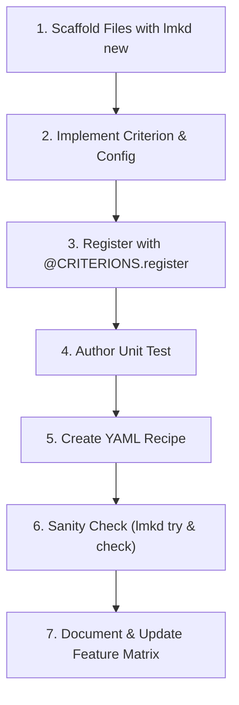

# How-To: Adding a New Baseline

This guide walks through the exact workflow required to implement, test, and register a new knowledge distillation baseline in LM-KD.

---

## The Complete Baseline Checklist

Follow this 7-step checklist whenever contributing a new method:



---

## Step 1: Scaffold Boilerplate with `lmkd new`

Use the CLI scaffolding tool to generate the implementation file, unit test, and minimal recipe:

```bash
# Example: Adding a new divergence called "alpha_div"
lmkd new criterion alpha_div
```

This automatically generates:
- `src/lmkd/losses/alpha_div.py`
- `tests/losses/test_alpha_div.py`
- `recipes/testing/alpha_div.yaml`

---

## Step 2: Implement the Criterion

Edit `src/lmkd/losses/alpha_div.py`. Inherit from [`Criterion`](../../src/lmkd/losses/base.py) and define your Pydantic `Config`:

```python
from lmkd.core.registry import CRITERIONS
from lmkd.core.plugin import BaseConfig
from lmkd.losses.base import Criterion, LossContext, LossOutput, LossTerm
from lmkd.models.forward import FeatureRequest, SideRequest
import torch
import torch.nn.functional as F

@CRITERIONS.register(
    "alpha_div",
    paper="arXiv:2401.xxxxx",
    source="official_repo/losses.py:45",
    status="stable"
)
class AlphaDivergence(Criterion):
    """Alpha-Divergence Knowledge Distillation."""

    class Config(BaseConfig):
        alpha: float = 0.5
        temperature: float = 1.0

    def __init__(self, config: Config):
        super().__init__()
        self.alpha = config.alpha
        self.temp = config.temperature

    def features(self) -> FeatureRequest:
        # Declare what tensors the engine must provide
        return FeatureRequest(
            student=SideRequest(logits="view"),
            teacher=SideRequest(logits="view"),
        )

    def forward(self, ctx: LossContext) -> LossOutput:
        # Target-aligned convention via LogitsView
        s_logits = ctx.student_logits().full() / self.temp
        t_logits = (ctx.teacher.logits.full() if ctx.teacher else s_logits) / self.temp
        mask = ctx.supervised_mask("student")

        p_s = F.softmax(s_logits, dim=-1)
        p_t = F.softmax(t_logits, dim=-1)

        # Alpha-divergence numerator
        term = (p_t.pow(self.alpha) * p_s.pow(1.0 - self.alpha)).sum(dim=-1)
        per_token = (1.0 - term) / (self.alpha * (1.0 - self.alpha))
        numerator = (per_token * mask).sum()

        return LossOutput(
            terms={"alpha_div": LossTerm(value=numerator, reduction="token_sum")},
            metrics={"mean_alpha_div": numerator.detach() / mask.sum().clamp_min(1.0)}
        )
```

---

## Step 3: Write the Unit Test

Open `tests/losses/test_alpha_div.py` and implement tensor shape and backward checks:

```python
import pytest
import torch
from lmkd.core.registry import CRITERIONS

def test_alpha_divergence_backward():
    crit = CRITERIONS.build({"type": "alpha_div", "alpha": 0.5, "temperature": 1.0})
    
    # Mock inputs
    student_logits = torch.randn(2, 8, 100, requires_grad=True)
    teacher_logits = torch.randn(2, 8, 100)
    
    # Compute forward
    out = crit.compute_loss(student_logits, teacher_logits)
    loss = out.terms["alpha_div"].value
    
    # Verify backward pass
    loss.backward()
    assert student_logits.grad is not None
    assert not torch.isnan(student_logits.grad).any()
```

Run test:
```bash
pytest tests/losses/test_alpha_div.py
```

---

## Step 4: Create the Experiment Recipe

Create `recipes/same_tokenizer/alpha_div.yaml`:

```yaml
_base_:
  - ../_base_/engine_zero2.yaml
  - ../_base_/optim_muon_talas.yaml

models:
  student:
    path: Qwen/Qwen2.5-0.5B
    dtype: bf16
  teacher:
    path: Qwen/Qwen2.5-1.5B
    dtype: bf16

teacher:
  provider: hf_frozen
  input: same

loss:
  terms:
    - criterion: alpha_div
      params:
        alpha: 0.5
        temperature: 1.5

data:
  train:
    type: hf_dataset
    path: databricks/databricks-dolly-15k
    split: train
  max_length: 2048
```

---

## Step 5: Sanity Check and Execution

Test your new criterion in isolation using `lmkd try`:
```bash
lmkd try alpha_div --params '{"alpha": 0.5, "temperature": 1.5}'
```

Validate recipe consistency:
```bash
lmkd check -c recipes/same_tokenizer/alpha_div.yaml
```

Run a test training iteration:
```bash
lmkd train -c recipes/same_tokenizer/alpha_div.yaml --set train.max_steps=10
```

