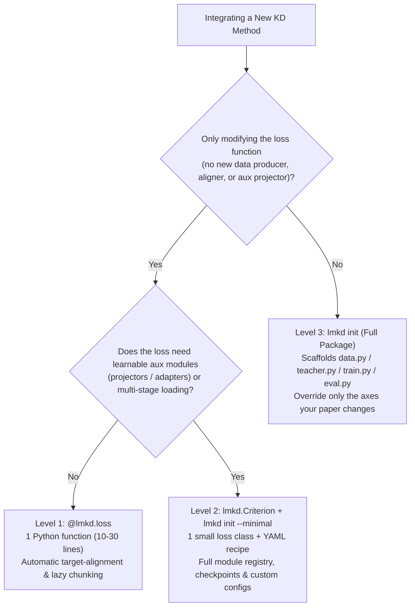
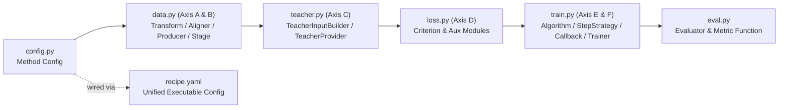

# Newcomer Method Integration Guide

This guide explains how to integrate a new knowledge distillation (KD) or alignment method into **LM-KD** quickly while reusing the framework's built-in data pipelines, teacher providers, distributed execution engines, and lazy chunked logit computation.

---

## 1. Decision Tree: 3 Levels of Integration

Choose the simplest integration level that covers your method:



| Level | Best For | Entrypoint / Scaffolding | Capabilities |
|---|---|---|---|
| **Level 1 (`@lmkd.loss`)** | Novel logit divergences, regularizers, hidden/logit objectives without learnable modules | Write 1 function in `my_loss.py` and load via `imports:` or `lmkd.quick(..., loss=my_fn)` | Automatic target-alignment, lazy chunked backward on large vocabularies, auto Pydantic config from function signature |
| **Level 2 (`Criterion`)** | Losses with trainable projectors (`nn.Linear` / MLPs), multi-stage checkpoints, or cross-tokenizer criteria | `lmkd init my_method --minimal` | `build_modules()`, `load_aux_checkpoint()`, `prepare()`, `make_features()`, multi-GPU ZeRO-3 / FSDP2 safe |
| **Level 3 (Full Package)** | Complete multi-axis papers introducing custom data producers, token aligners, teacher signal policies, or training loops | `lmkd init my_method` (or `--baseline`) | Full control over Axis A–F (`data.py`, `teacher.py`, `loss.py`, `train.py`, `eval.py`) with `super()` fallback for untouched axes |

> [!NOTE]
> **What about `@lmkd.register_loss` and `@lmkd.compute_loss`?**
> Those are HF-positional compatibility helpers (`lmkd.losses.hf_compat`) intended only for porting raw `transformers.Trainer` code verbatim (where you slice `[:, :-1]` manually and materialize full `[B, T, V]` logits). For all new methods, prefer **Level 1 (`@lmkd.loss`)** or **Level 2 (`lmkd.Criterion`)**.

---

## 2. Three Golden Rules of LM-KD

Understanding these three invariants prevents 90% of subtle bugs when implementing custom distillation losses.

### Rule 1: Everything Is Target-Aligned

In LM-KD, `logits`, `labels`, `mask`, `Inputs.last_hidden` / `Inputs.hidden`, and `ctx.student_target_hidden(l)` are **already shifted** so index `t` corresponds to **predicting target token `input_ids[:, t]`**:

```text
Positional HF tensors (s.side.hidden / s.side.last_hidden / ctx.student_hidden):
  index:   0        1        2        3
  state:  h(x0)    h(x1)    h(x2)    h(x3)    <- index p predicts token p+1

Target-aligned LM-KD convention (logits / labels / mask / Inputs.last_hidden / student_target_hidden):
  index:   0        1        2        3
  pred:   [0]      h(x0)    h(x1)    h(x2)    <- shifted right by 1
  label:  -100      x1       x2       x3      <- target token at index t
  mask:    0.0      1.0      1.0      1.0     <- index 0 is never supervised
```

- **Do NOT write** `logits[:, :-1]` or `labels[:, 1:]` inside `@lmkd.loss` or `Criterion.forward()`.
- If you explicitly need raw positional hidden states (for instance, for token pooling in an embedding model or custom index shifting), use `ctx.student_hidden(layer)` in `Criterion` or `s.positional_hidden(layer)` inside `@lmkd.loss`.

### Rule 2: Return Unnormalized Numerators (`token_sum` / `seq_sum`)

Never divide a token-level loss by `mask.sum()` or `batch_size` inside `forward()`. In distributed training and gradient accumulation, averaging per-micro-batch averages produces biased gradients whenever micro-batches have uneven supervised token counts (e.g., variable prompt lengths).

Return the **sum** over valid tokens (`(per_token * mask).sum()`) with `reduction="token_sum"` (or `TokenLoss(per_token, mask)` in `@lmkd.loss`). LM-KD's `LossAggregator` automatically reduces across all micro-batches and ranks using the exact global token denominator $Z_{\text{tok}}$.

### Rule 3: Keep Logits Lazy with `LogitsView` and Capture Only Required Layers

For models with large vocabularies (e.g., Qwen3 with $V = 151{,}936$), materializing a full `[B, T, V]` fp32 logits tensor wastes gigabytes of VRAM:
- With **`@lmkd.loss`**, token-wise objectives are automatically chunked along the sequence dimension unless `chunked=False` is set or global/hidden tensors are accessed.
- With **`Criterion`**, declare `logits="view"` in `features()` (or `self.make_features(student_logits="view", ...)`) and use `view.target_logp(labels)`, `view.topk(k)`, or `for chunk in view.chunks(): ...` instead of calling `.full()` when possible.
- Request only the specific hidden layers you need (`student_hidden=(-4, -1)`) instead of `"all"`. LM-KD installs lightweight forward hooks to capture just those layers without holding all $L+1$ layers in memory.

---

## 3. Built-In Framework Building Blocks You Can Reuse

You rarely need to write data loading, teacher caching, optimizer wrapping, or on-policy generation from scratch:

### Top-Level Imports

Every common primitive is exported directly from top-level `lmkd`:

```python
import lmkd
from lmkd import (
    BaseConfig,
    Criterion,
    Inputs,
    LossContext,
    LossOutput,
    LossTerm,
    ModelPairInfo,
    ScalarLoss,
    SeqLoss,
    TokenLoss,
    CRITERIONS,
)
```

### Ergonomic Shortcuts on `LossContext`

Inside `Criterion.forward(self, ctx: LossContext)`:
- **Logits views:** `ctx.student_logits()`, `ctx.teacher_logits()`
- **Target-aligned hidden states:** `ctx.student_target_hidden(layer=-1)`, `ctx.teacher_target_hidden(layer=-1)`
- **Raw HF positional hidden states:** `ctx.student_hidden(layer=-1)`, `ctx.teacher_hidden(layer=-1)`
- **Batch tensors & masks:** `ctx.labels`, `ctx.input_ids`, `ctx.attention_mask`, `ctx.mask` (equivalent to `ctx.supervised_mask("student")`)

### Declarative Features on `Criterion`

Instead of manually nesting `FeatureRequest(student=SideRequest(...), teacher=SideRequest(...), teacher_signal=TeacherSignalSpec(...))`, either call `self.make_features(...)` or declare class attributes:

```python
class MyCriterion(lmkd.Criterion):
    needs_teacher = True
    student_logits_mode = "view"
    teacher_logits_mode = "view"
    student_hidden_layers = (-1,)
    teacher_hidden_layers = (-1,)
```

Or use `self.make_features(...)` when feature specs depend on `self.cfg`:

```python
def features(self) -> lmkd.FeatureRequest:
    return self.make_features(
        student_logits="view",
        teacher_logits="view",
        student_hidden=tuple(self.cfg.student_layers),
        teacher_hidden=tuple(self.cfg.teacher_layers),
    )
```

### Reusable Divergences, Projectors, Producers, and Teachers

| Need | Built-in Reuse Option |
|---|---|
| **Standard Divergences** | `lmkd.losses.functional.divergences`: `forward_kl`, `reverse_kl`, `js_distance`, `tv_distance`, `skewed_forward_kl`, `skewed_reverse_kl`, `csd` |
| **Trainable Projectors** | `self.register_aux_module(modules, "proj", nn.Linear(...))` in `build_modules()`, then call `self.proj(x)` in `forward()`, and reload via `self.load_aux_checkpoint(ctx, "proj")` in `prepare()` |
| **Combining Loss Terms** | Add `nll` + your custom criterion directly in `loss.terms` in YAML with dynamic `loss.schedules` (warmup/decay) |
| **On-Policy / Off-Policy Mix** | Configure `producer: {type: mixed, lmbda: 0.5}` (GKD) or `producer: {type: adaptive_sgo}` (DistiLLM) in YAML — no Python producer code required |
| **Self-Distillation Teacher** | Configure `teacher: {provider: {type: self, weight_policy: ema}}` (or `periodic_sync` / `trust_region`) in YAML |
| **Privileged / Hindsight Inputs** | Configure `teacher: {input: privileged_prompt}` or `teacher: {input: hindsight}` in YAML |
| **Cross-Tokenizer Alignment** | Reuse `aligners` (`eta`, `lcs`, `dtw`, `ot`) via `data.transforms` and helpers in `lmkd.losses.cross_tokenizer._common` (`target_hidden`, `view_from_target_hidden`) |

---

## 4. Practical Recipes Across All 3 Integration Levels (1 -> 2 -> 3)

### Recipe 1 (Level 1): Custom Token-Level Divergence with `@lmkd.loss`

Create `dev/my_fkl.py`:

```python
import torch.nn.functional as F
import lmkd
from lmkd import Inputs, TokenLoss


@lmkd.loss("entropy_weighted_fkl", teacher=True)
def entropy_weighted_fkl(s: Inputs, t: Inputs, temperature: float = 1.0, alpha: float = 1.0) -> TokenLoss:
    t_probs = F.softmax(t.logits / temperature, dim=-1)
    t_logp = F.log_softmax(t.logits / temperature, dim=-1)
    s_logp = F.log_softmax(s.logits / temperature, dim=-1)

    kl = (t_probs * (t_logp - s_logp)).sum(dim=-1)
    entropy = -(t_probs * t_logp).sum(dim=-1).detach()
    weights = (1.0 + alpha * entropy)
    return TokenLoss(kl * weights * (temperature ** 2), s.mask)
```

Run a 1-second synthetic test (files inside `dev/` are auto-discovered, so `--plugins` is optional) or launch training directly from Python:

```bash
lmkd try entropy_weighted_fkl
```

```python
import lmkd

rt = lmkd.quick(
    student="Qwen/Qwen2.5-0.5B",
    teacher="Qwen/Qwen2.5-1.5B",
    data="examples/data/train_sample.jsonl",
    loss=entropy_weighted_fkl,
    max_steps=10,
)
rt.fit()
```

### Recipe 2 (Level 2): Hidden Alignment with a Learnable Projector (`lmkd init --minimal`)

Scaffold a minimal package:

```bash
lmkd init hidden_align --minimal
```

Edit `dev/hidden_align/loss.py`:

```python
from __future__ import annotations

from typing import ClassVar
import torch.nn as nn
import torch.nn.functional as F

import lmkd
from lmkd import BaseConfig, CRITERIONS, Criterion, LossContext, LossOutput, LossTerm, ModelPairInfo


@CRITERIONS.register("hidden_align", status="experimental", force=True)
class HiddenAlignLoss(Criterion):
    needs_teacher: ClassVar[bool] = True
    supports_packing: ClassVar[bool] = True

    class Config(BaseConfig):
        student_layer: int = -1
        teacher_layer: int = -1

    def features(self) -> lmkd.FeatureRequest:
        return self.make_features(
            student_hidden=(self.cfg.student_layer,),
            teacher_hidden=(self.cfg.teacher_layer,),
        )

    def build_modules(self, info: ModelPairInfo, modules) -> None:
        t_dim = info.teacher_hidden or info.student_hidden
        self.register_aux_module(modules, "proj", nn.Linear(info.student_hidden, t_dim, bias=False))

    def forward(self, ctx: LossContext) -> LossOutput:
        s_h = self.proj(ctx.student_target_hidden(self.cfg.student_layer))
        t_h = ctx.teacher_target_hidden(self.cfg.teacher_layer).detach()
        per_tok = F.mse_loss(s_h, t_h, reduction="none").mean(dim=-1)
        loss_num = (per_tok * ctx.mask).sum()
        return LossOutput(terms={"hidden_align": LossTerm(loss_num, "token_sum")})
```

Test it in 1 second without `--plugins` (auto-discovered from `dev/`):

```bash
lmkd try hidden_align
```

### Recipe 3: Mixing NLL + Custom KD + On-Policy Producer in YAML (Zero Python Loop Changes)

Even if you only wrote `dev/my_fkl.py` (Recipe 1), LM-KD **auto-discovers plugins inside `dev/`, `src/lmkd/`, and `src/baselines/`** — so no `imports:` line is needed (reserve `imports:` only for `.py` files outside those folders, resolved relative to the YAML file):

```yaml
name: gkd_entropy_fkl

models:
  student:
    path: Qwen/Qwen2.5-0.5B
    trainable: true
  teacher:
    path: Qwen/Qwen2.5-1.5B

data:
  train:
    type: jsonl
    path: examples/data/train_sample.jsonl
  transforms:
    - type: tokenize_sft
      use_chat_template: false

teacher:
  provider: hf_frozen   # or {type: self, weight_policy: ema} for self-distillation without models.teacher
  input: same

producer:
  type: mixed
  lmbda: 0.5          # 50% on-policy student rollouts, 50% dataset samples
  sampling:
    max_new_tokens: 128

rollout:
  type: hf            # required whenever producer generates on-policy rollouts (use 'vllm_colocate' for fast GPU rollouts)

loss:
  terms:
    - criterion: nll
      weight: 0.2
    - criterion: entropy_weighted_fkl
      weight: 0.8
      params:
        temperature: 1.5
```

#### When & How to Use `imports:` in `recipe.yaml`

Plugins placed under `dev/`, `src/lmkd/`, or `src/baselines/` are **auto-discovered** by LM-KD without listing them in `imports:`. Use `imports:` when your custom `.py` file lives outside those directories (e.g., under `examples/` or an experiment folder), or inside a self-contained recipe bundle:

> [!IMPORTANT]
> Relative `.py` paths in `imports:` are resolved **relative to the directory containing the YAML file** (not the workspace root). Dotted module names (without `.py` or `/`) are imported via standard Python `PYTHONPATH`.

```yaml
# Example A: Same-folder plugins (inside dev/my_method/recipe.yaml)
imports: [config.py, loss.py, data.py, teacher.py, train.py, eval.py]

# Example B: Relative path from recipes/experimental/my_exp.yaml -> ../../examples/my_losses.py
imports:
  - ../../examples/my_losses.py

# Example C: Installed package or PYTHONPATH dotted module
imports:
  - my_research_pkg.custom_losses
```

### Recipe 4 (Level 3): Developing a Brand-New Multi-Axis Method from Scratch (`lmkd init`)

When a paper or new research idea modifies **more than just the loss** — for example, custom per-sample transforms, dynamic/on-policy batch production, privileged teacher inputs, custom teacher EMA/provider logic, custom optimizer/gradient step strategies, or custom evaluation metrics — scaffold a full 6-axis package:

```bash
# Local development under dev/my_method/
lmkd init my_method

# Or official baseline contribution under src/baselines/<domain>/my_method/
lmkd init my_method --baseline --domain same_tokenizer
```

Because every generated file inherits from LM-KD's canonical defaults via `super()`, **you only edit the axes your method actually changes** and leave the rest untouched. See Section 5 below for the complete per-axis guide.

---

## 5. Level 3 Deep Dive: Customizing Every Axis (`lmkd init` Full Package)

A full package generated by `lmkd init <name>` separates your method cleanly along LM-KD's six architectural axes:



### 5.1 Generated Package Anatomy & `super()` Fallback Contract

| File | Axis | Registry & Base Class | Default When Unmodified (`super()`) | What `lmkd init` Also Generates |
|---|---|---|---|---|
| `__init__.py` | Packaging | `load_plugins()` / module exports | Auto-imports & registers all package plugins | Export list (`__all__`) |
| `config.py` | Schema | Method hyperparameter config | Standalone defaults (`temperature`, `alpha`, `chunk_size`) | — |
| `data.py` | Axis A & B | `TRANSFORMS` (`Transform`), `PRODUCERS` (`DatasetProducer`), `STAGES` (`Stage`) | Pass-through transform, standard off-policy `DatasetProducer`, no-op `Stage` | Can also register `ALIGNERS` + custom `FIELDS` |
| `teacher.py` | Axis C | `TEACHER_INPUTS` (`SameInput`), `TEACHERS` (`HFFrozenTeacher`) | Teacher receives identical student inputs & online frozen logits/hiddens | Custom `build()` / `signals()` / `on_optimizer_step()` |
| `loss.py` | Axis D | `CRITERIONS` (`NLL` or `Criterion`) | Canonical NLL teacher-forced objective | Full access to `features()`, `build_modules()`, `prepare()`, `forward()`, `on_step_end()` |
| `train.py` | Axis E & F | `ALGORITHMS` (`Standard`), `STEP_STRATEGIES` (`StandardStep`), `CALLBACKS` (`Callback`), `Trainer` | Canonical `Standard` forward/loss + `StandardStep` accumulation + `Trainer.fit()` | Standalone `python -m dev.<name>.train` CLI entrypoint |
| `eval.py` | Eval | `EVALUATORS` (`DevLoss`) + pure metric fn | Teacher-forced `DevLoss` evaluation | Custom generation/benchmark evaluator |
| `recipe.yaml` | Wiring | Executed by `lmkd train -c ...` | Wires all package plugins together cleanly | Copy at `recipes/<domain>/<name>.yaml` + `tests/unit/test_<name>.py` |

> [!TIP]
> **Incremental Development Strategy:**
> 1. Start by running `lmkd check -c dev/my_method/recipe.yaml` immediately after `lmkd init my_method` — it works out of the box via `super()`.
> 2. Replace one axis at a time (`data.py` -> `teacher.py` -> `loss.py` -> `train.py` -> `eval.py`), keeping the remaining classes untouched.
> 3. For a complete real-world Level 3 walkthrough combining custom `data.py` (Adaptive SGO + MTA span aligner), `teacher.py` (Privileged Prompt + response-shift), and `loss.py`, read **[Building a New Method with `lmkd init`](../tutorials/building-a-method-with-lmkd-init.md)**.

### 5.2 Axis-by-Axis Implementation Guide

#### 1. `config.py` — Shared Hyperparameter Schema

Define default hyperparameters for your method. Use `lmkd.BaseConfig` (Pydantic-backed, validates YAML overrides cleanly) or a dataclass:

```python
from __future__ import annotations
from lmkd import BaseConfig


class MyMethodConfig(BaseConfig):
    temperature: float = 1.0
    alpha: float = 0.5
    rollout_ratio: float = 0.5
    ema_decay: float = 0.999
```

#### 2. `data.py` (Axis A & B) — Custom Fields, `Transform`, `BatchProducer`, & Offline `Stage`

1. **Register new batch keys (`FIELDS`)** before producing or consuming custom tensors/metadata:
   ```python
   import torch
   from lmkd import FIELDS, FieldSpec

   if "student.sample_weight" not in FIELDS:
       FIELDS.register(FieldSpec("student.sample_weight", "tensor", torch.float32, 0.0, None, "[B] per-sample weight"))
   ```
   Supported `FieldSpec` kinds: `"tensor"` (padded along sequence/batch), `"ragged"` (variable-length lists/spans), and `"meta"` (non-tensor Python metadata such as prompt strings).

2. **Customize `Transform`** (per-sample preprocessing during tokenization/collation):
   ```python
   from typing import Any, ClassVar
   from lmkd import BaseConfig, TRANSFORMS
   from lmkd.data.context import DataContext
   from lmkd.data.transforms.base import Transform

   @TRANSFORMS.register("my_method_transform", status="experimental", force=True)
   class MyMethodTransform(Transform):
       requires: ClassVar[tuple[str, ...]] = ("student.input_ids",)
       provides: ClassVar[tuple[str, ...]] = ("student.sample_weight",)

       class Config(BaseConfig):
           default_weight: float = 1.0

       def __call__(self, sample: dict[str, Any], ctx: DataContext) -> dict[str, Any] | None:
           sample["student.sample_weight"] = self.cfg.default_weight
           return sample
   ```

3. **Customize `BatchProducer`** (how global batches are constructed each optimizer step — e.g. on-policy student generation, curriculum scheduling, or replay mixing):
   ```python
   from typing import Any
   from lmkd import Batch, PRODUCERS
   from lmkd.core.state import TrainState
   from lmkd.data.producers import DatasetProducer

   @PRODUCERS.register("my_method_producer", status="experimental", force=True)
   class MyMethodProducer(DatasetProducer):
       class Config(DatasetProducer.Config):
           rollout_ratio: float = 0.5

       def setup(self, rt: Any) -> None:
           super().setup(rt)

       def next(self, state: TrainState) -> Batch:
           batch = super().next(state)
           # Call self.make_on_policy_batch(batch) or mix with replay buffers here
           return batch

       def on_eval(self, metrics: dict[str, Any]) -> None:
           # Inspect dev metrics (e.g. metrics.get("dev_loss/loss")) for adaptive sampling
           super().on_eval(metrics)
   ```

4. **Customize `Stage`** (optional cached, content-addressed offline preprocessing run via `lmkd pipeline`):
   - Implement `run(self, ctx: StageContext) -> dict[str, Any]` to write artifacts under `ctx.output.path`.
   - Implement `attach(self, art: Artifact, rt: Any) -> None` to expose cached artifact paths on `rt` before training starts.

#### 3. `teacher.py` (Axis C) — `TeacherInputBuilder` & `TeacherProvider`

1. **`TeacherInputBuilder`** constructs `teacher.*` keys from the student `Batch` (e.g., privileged teacher prompt, hindsight targets, or alternate tokenizer inputs):
   ```python
   from typing import Any
   from lmkd import Batch, TEACHER_INPUTS
   from lmkd.teachers.input_builders import SameInput

   @TEACHER_INPUTS.register("my_method_teacher_input", status="experimental", force=True)
   class MyMethodTeacherInput(SameInput):
       class Config(SameInput.Config):
           prefix: str = "Reference context:\n"

       def build(self, batch: Batch, rt: Any) -> Batch:
           # Populate teacher.input_ids, teacher.attention_mask, and optional teacher.response_shift_index
           return super().build(batch, rt)
   ```

2. **`TeacherProvider`** controls how teacher forward passes and parameter updates work:
   ```python
   from typing import Any
   from lmkd import Batch, SideOutput, SideRequest, TEACHERS, TeacherOutput, TeacherSignalSpec
   from lmkd.core.state import TrainState
   from lmkd.teachers.providers import HFFrozenTeacher

   @TEACHERS.register("my_method_teacher", status="experimental", force=True)
   class MyMethodTeacher(HFFrozenTeacher):
       class Config(HFFrozenTeacher.Config):
           pass

       def signals(
           self,
           batch: Batch,
           spec: TeacherSignalSpec | None,
           req: SideRequest | None,
           student: SideOutput | None,
       ) -> TeacherOutput | None:
           return super().signals(batch, spec, req, student)

       def on_optimizer_step(self, state: TrainState) -> None:
           # Optional hook after each optimizer update (e.g., custom EMA/momentum sync)
           super().on_optimizer_step(state)
   ```

#### 4. `loss.py` (Axis D) — Full `Criterion` Lifecycle

When building a Level 3 loss, inherit from `Criterion` (or `NLL`) and leverage all lifecycle hooks:
- `features() -> FeatureRequest`: use `self.make_features(...)` to request only the exact logits (`"view"`) and hidden layers needed.
- `build_modules(info: ModelPairInfo, modules)`: register trainable projectors/critics via `self.register_aux_module(modules, "name", module)` so they automatically join optimizer parameter groups, ZeRO/FSDP sharding, and checkpoints.
- `prepare(ctx: PrepareContext)`: run one-time calibration or load pre-trained aux weights via `self.load_aux_checkpoint(ctx, "name")`.
- `forward(ctx: LossContext) -> LossOutput`: return unnormalized numerators (`LossTerm(val, "token_sum")` or `"seq_sum"`).
- `on_step_end(state: TrainState)`: update internal moving baselines or schedules after each step.

#### 5. `train.py` (Axis E & F) — `Algorithm`, `StepStrategy`, `Callback`, & Custom `Trainer`

Override only the training execution layer your method requires:
- **`Algorithm` (`@ALGORITHMS.register`)**:
  - `augment(self, batch: Batch, rt: Any) -> Batch`: step-level enrichment before micro-batch splitting (e.g., compute RL advantages, prepare teacher inputs once per global batch).
  - `loss(self, micro: Batch, rt: Any) -> list[WeightedOutput]`: micro-batch student forward + teacher signals + criterion evaluation.
- **`StepStrategy` (`@STEP_STRATEGIES.register`)**:
  - Override `micro_batches()`, `global_norms()`, `accumulate()`, `apply_grad_transforms()`, `optimizer_step()`, or `run()` if your method changes gradient accumulation, normalization, or multi-optimizer updates (e.g., alternating student/critic updates).
- **`Callback` (`@CALLBACKS.register`)**:
  - Hook into `on_train_begin`, `on_step_begin`, `on_step_end`, `on_eval`, `on_save`, `on_train_end`.
- **`Trainer` & standalone CLI**:
  - Subclass `lmkd.train.trainer.Trainer` only if you change the outer loop (`fit()` / `train_step()`); unmodified `MyMethodTrainer(Trainer)` inherits canonical `Trainer.fit()`.
  - Launch directly with `python -m dev.my_method.train -c dev/my_method/recipe.yaml` or standard `lmkd train -c dev/my_method/recipe.yaml`.

#### 6. `eval.py` — Pure Metrics & Registered `Evaluator`

Split evaluation logic into:
1. A pure reusable function (`def my_method_metric(model, tokenizer, records) -> dict[str, float]`).
2. A registered `Evaluator` (`@EVALUATORS.register("my_method_eval")`, defaulting to `DevLoss`) wired into `recipe.yaml` under `eval:`.

#### 7. Wiring Everything in `recipe.yaml`

Connect all custom plugins cleanly in `dev/my_method/recipe.yaml` (files in `dev/` or `src/baselines/` are auto-discovered; `lmkd init` also lists YAML-relative `imports:` for standalone portability):

```yaml
name: my_method
imports: [config.py, loss.py, data.py, teacher.py, train.py, eval.py]

models:
  student:
    path: Qwen/Qwen2.5-0.5B
  teacher:
    path: Qwen/Qwen2.5-1.5B

data:
  train: {type: jsonl, path: examples/data/train_sample.jsonl}
  transforms:
    - type: tokenize_sft
    - type: my_method_transform
  max_length: 1024

producer:
  type: my_method_producer

teacher:
  provider:
    type: my_method_teacher
  input:
    type: my_method_teacher_input

algorithm:
  type: my_method_algorithm

step:
  type: my_method_step

loss:
  aggregator: weighted_sum
  terms:
    - criterion: my_method
      weight: 1.0
      params:
        temperature: 1.0

eval:
  - type: my_method_eval
    data: {type: jsonl, path: examples/data/train_sample.jsonl}
    when: epoch
```

---

## 6. Step-by-Step Verification Workflow

Follow this progression to catch bugs immediately on CPU before allocating multi-GPU nodes:

```bash
# 1. Scaffold cleanly (use --minimal for loss-only methods, or omit for full 6-axis package)
lmkd init my_method --minimal

# 2. 1-second CPU synthetic gradient probe (runs build_modules() + forward() + backward())
lmkd try my_method

# 3. Validate config schema, required batch fields, and teacher requirements
lmkd check -c dev/my_method/recipe.yaml

# 4. Run 1 real micro-batch forward + backward pass on the configured models & dataset
lmkd check -c dev/my_method/recipe.yaml --preflight

# 5. Run unit tests & train
pytest -q tests/unit/test_my_method.py
lmkd train -c dev/my_method/recipe.yaml --set train.max_steps=10
```
