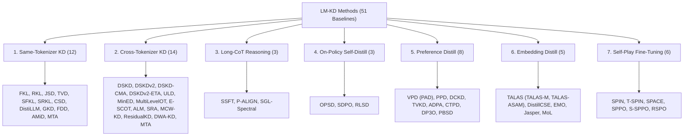

# Distillation Methods & Baseline Catalog

LM-KD provides complete, verified implementations of **51 core baseline methods**, organized across 7 distinct research groups. Every method is implemented under a unified contract and accessible via declarative YAML recipes.

All baselines in this catalog are aligned with the official publication records documented in the [Baseline Methods & Paper Registry](../scenarios/index.md#baseline-methods--paper-registry).

---

## 1. Baseline Families Overview

---

## 2. Master Baseline Table

| Method Family | Count | Key Baselines | Distillation Focus | Primary Recipe | Documentation & Papers |
| :--- | :---: | :--- | :--- | :--- | :--- |
| **[Same-Tokenizer](same-tokenizer.md)** | 12 | `FKL`, `RKL`, `JSD`, `TVD`, `SFKL`, `SRKL`, `CSD`, `DistiLLM`, `GKD`, `FDD`, `AMiD`, `MTA` | Logit distribution matching when $\mathcal{V}_S \equiv \mathcal{V}_T$ | [`recipes/same_tokenizer/fkl.yaml`](../../recipes/same_tokenizer/fkl.yaml) | [Detailed Formulations & Papers](same-tokenizer.md) |
| **[Cross-Tokenizer](cross-tokenizer.md)** | 14 | `DSKD`, `DSKDv2`, `DSKD-CMA`, `DSKDv2-ETA`, `ULD`, `MinED`, `MultiLevelOT`, `E-SCOT`, `ALM`, `SRA`, `MCW-KD`, `ResidualKD`, `DWA-KD`, `MTA` | Vocabulary & hidden representation alignment when $\mathcal{V}_S \neq \mathcal{V}_T$ | [`recipes/cross_tokenizer/dskdv2.yaml`](../../recipes/cross_tokenizer/dskdv2.yaml) | [Detailed Formulations & Papers](cross-tokenizer.md) |
| **[Long-CoT](long-cot.md)** | 3 | `SSFT`, `P-ALIGN`, `SGL-Spectral` | Step-level mathematical reasoning chain distillation | [`recipes/long_cot/sgl_spectral.yaml`](../../recipes/long_cot/sgl_spectral.yaml) | [Detailed Formulations & Papers](long-cot.md) |
| **[On-Policy Self-Distill](on-policy-self-distill.md)** | 3 | `OPSD`, `SDPO`, `RLSD` | Self-improvement via student rollouts & verifiers | [`recipes/self_distill/opsd.yaml`](../../recipes/self_distill/opsd.yaml) | [Detailed Formulations & Papers](on-policy-self-distill.md) |
| **[Preference Distill](preference-distill.md)** | 8 | `VPD (PAD)`, `PPD`, `DCKD`, `TVKD`, `ADPA`, `CTPD`, `DP3O`, `PBSD` | Reward-model-free direct preference distillation | [`recipes/preference/pad.yaml`](../../recipes/preference/pad.yaml) | [Detailed Formulations & Papers](preference-distill.md) |
| **[Embedding Distill](embedding-distill.md)** | 5 | `TALAS`, `DistillCSE`, `EMO`, `Jasper`, `MoL` | Dense sentence representation compression | [`recipes/embedding/talas_m.yaml`](../../recipes/embedding/talas_m.yaml) | [Detailed Formulations & Papers](embedding-distill.md) |
| **[Self-Play](self-play.md)** | 6 | `SPIN`, `T-SPIN`, `SPACE`, `SPPO`, `S-SPPO`, `RSPO` | Iterative game-theoretic self-play alignment | [`recipes/self_play/spin.yaml`](../../recipes/self_play/spin.yaml) | [Detailed Formulations & Papers](self-play.md) |

---

## 3. Selecting the Right Method

1. **If Student and Teacher share the same tokenizer:**
   - Use `FKL` (Hinton et al., 2015) for standard mode-covering instruction following on human demonstration data.
   - Use `RKL` (MiniLLM; Gu et al., ICLR 2024) or `CSD` (Concrete Score Distillation; Kim et al., ICLR 2026) for mode-seeking precision, avoiding student hallucination.
   - Use `DistiLLM` (Ko et al., ICML 2024; combining `SRKL` with Adaptive SGO) for memory-efficient generation optimization.
   - Use `GKD` (Agarwal et al., ICLR 2024) for mixing student on-policy rollouts with off-policy data to mitigate exposure bias.
   - Use `AMiD` (α-mixture Assistant Distribution; Shin et al., ICLR 2026) for intermediate assistant-distribution interpolation between teacher and student.
   - Use `FDD` (Gong et al., ACL 2025) to align layer-to-layer feature progression dynamics.
   - Use `DistiLLM + MTA` or `AMiD + MTA` (Multi-Granular Trajectory Alignment; Chi et al., ACL 2026) for layer-adaptive word- and phrase-level geometry matching.
2. **If Student and Teacher have different tokenizers (e.g., Qwen $\rightarrow$ GPT-2 / OPT / TinyLLaMA):**
   - Use `DSKD` (Zhang et al., EMNLP 2024) or `DSKDv2` (Zhang et al., 2025) for dual-space projection with Moore-Penrose pseudoinverse initialization and agreement masks.
   - Use `ULD` (Boizard et al., TMLR 2025) for pure vocabulary-independent sorted rank profile matching.
   - Use `MinED` (FuseLLM; Wan et al., ICLR 2024) for dynamic-programming minimum-edit-distance monotonic token alignment.
   - Use `MultiLevelOT` (Cui et al., AAAI 2025) for hierarchical optimal transport across unaligned token sequences.
   - Use `E-SCOT` (Entropy-aware Span-Constrained OT; Liu et al., ICML 2026) for linear-time span-constrained optimal transport with Rényi-entropy reweighting in low-overlap regimes.
   - Use `ALM` (Approximate Likelihood Matching; Minixhofer et al., NeurIPS 2025) for likelihood matching across chunk matrices (TokenKit).
   - Use `SRA` (Span Representation Alignment; Dao et al., ACL 2026) for Center-of-Mass span alignment via Longest Common Subsequence.
   - Use `MCW-KD` (Multi-Cost Wasserstein KD; Vuong et al., AAAI 2026) for multi-cost optimal transport simultaneously supervising representations and logits.
   - Use `ResidualKD` (On et al., ICLR 2026) for decoupled projector pretraining and residual learning.
   - Use `DWA-KD` (Dual-Space Weighting and Time-Warped Alignment; Vu et al., Findings EACL 2026) for entropy-weighted dual-space matching and Soft-DTW.
   - Use `DSKDv2 + MTA` for combined dual-space projection and phrase-level trajectory matching.
3. **If compressing multi-step reasoning (Math, Code, Long-CoT):**
   - Use `SSFT` (*Segment-Level Attribution for Selective Learning of Long Reasoning Traces*; Wang, Liu & Ren, ICLR 2026) to prune uninformative steps via Integrated Gradients attribution and direction consistency.
   - Use `P-ALIGN` (*Long-Chain Reasoning Distillation via Adaptive Prefix Alignment*; Liu et al., ACL 2026) for adaptive prefix truncation identifying the minimal guiding prefix.
   - Use `SGL-Spectral` (*Uncovering the Gradient Geometry of Long CoT: A Spectral-guided Approach to Reasoning Distillation*; Fan et al., ICML 2026) for SVD projection onto the low-rank consensus gradient subspace.
4. **If training on-policy with verifiers / self-guidance:**
   - Use `OPSD` (*Self-Distilled Reasoner: On-Policy Self-Distillation for Large Language Models*; Zhao et al., ICML 2026) for privileged-context self-distillation guided by generalized JSD or top-$k$ RKL.
   - Use `SDPO` (*Reinforcement Learning via Self-Distillation*; Hübotter et al., ICML 2026) for Self-Distillation Policy Optimization leveraging rich textual environment feedback.
   - Use `RLSD` (*Self-Distilled RLVR*; Yang et al., 2026) for combined verifiable outcome reward and self-distillation update magnitude guidance.
5. **If aligning on preference data without a Reward Model:**
   - Use `VPD` / `PAD` or `PPD` (*Capturing Nuanced Preferences: Preference-Aligned Distillation for Small Language Models*; Gu et al., Findings ACL 2025) for vanilla or probabilistic preference distillation.
   - Use `DCKD` or `ADPA` (*Advantage-Guided Distillation for Preference Alignment in Small Language Models*; Gao et al., ICLR 2025) for dual-constrained distillation and teacher advantage-guided alignment.
   - Use `TVKD` (*Preference Distillation via Value-based Reinforcement Learning*; Kwon et al., NeurIPS 2025) for Teacher Value-based KD via potential-based reward shaping.
   - Use `CTPD` (*CTPD: Cross Tokenizer Preference Distillation*; Nguyen et al., AAAI 2026) for span-projected and importance-sampled cross-tokenizer preference alignment.
   - Use `DP3O` (*Towards Bridging the Gap Between Offline and Iterative Alignment via Preference Distillation*; Zhang et al., TMLR 2026) for offline distilled preference probability policy optimization.
   - Use `PBSD` (*Preference-Based Self-Distillation: Beyond KL Matching via Reward Regularization*; Yu et al., 2026) for reward-regularized self-distillation on-policy.
6. **If compressing dense sentence encoders:**
   - Use `TALAS` (*Teacher-Anchored Layer Alignment with Adaptive Sharpness-Aware Minimization for Embedding Distillation*; Dao et al., ACL 2026) with Muon (`TALAS-M`) or ASAM (`TALAS-ASAM`) for teacher-anchored layer distillation, layer-aligned self-distillation, and flat minima generalization.
   - Use `DistillCSE` (*DistillCSE: Distilled Contrastive Learning for Sentence Embeddings*; Xu et al., Findings EMNLP 2023) for full relational cosine similarity topology matching.
   - Use `EMO` (*EMO: Embedding Model Distillation via Intra-Model Relation and Optimal Transport Alignments*; Truong et al., EMNLP 2025) for intra-model relational similarities via CKA and optimal transport sequence alignments.
   - Use `Jasper` (*Jasper and Stella: Distillation of SOTA Embedding Models*; Zhang et al., 2024) for decoupled two-stage projector pretraining and joint InfoNCE fine-tuning.
   - Use `MoL` (*MoL: Mixture of Layers in Cross-Tokenizer Embedding Model Distillation*; Vu et al., Knowledge-Based Systems 2026) for learnable intermediate teacher layer mixture distillation.
7. **If aligning iteratively without external preferences (Self-Play):**
   - Use `SPIN` (*Self-Play Fine-Tuning Converts Weak Language Models to Strong Language Models*; Chen et al., ICML 2024) for adversarial self-play against earlier model iterations.
   - Use `T-SPIN` (*Triplets Better Than Pairs: Towards Stable and Effective Self-Play Fine-Tuning for LLMs*; Wang et al., NeurIPS 2025) for triplet-based self-play with historical advantage anchoring against proto-synthetic rollouts.
   - Use `SPACE` (*SPACE: Noise Contrastive Estimation Stabilizes Self-Play Fine-Tuning for Large Language Models*; Wang et al., NeurIPS 2025) for Noise Contrastive Estimation stabilizing gap-based self-play.
   - Use `SPPO` (*Self-Play Preference Optimization for Language Model Alignment*; Wu et al., ICLR 2025) for zero-sum game soft win-rate regression toward Nash equilibrium.
   - Use `S-SPPO` (*S-SPPO: Semantic-Calibrated Self-Play Preference Optimization*; Chen et al., ICML 2026) for semantic gating and representation repulsion.
   - Use `RSPO` (*RSPO: Regularized Self-Play Alignment of Large Language Models*; Tang et al., ICML 2026) for regularized self-play with reference policy divergence constraints.
