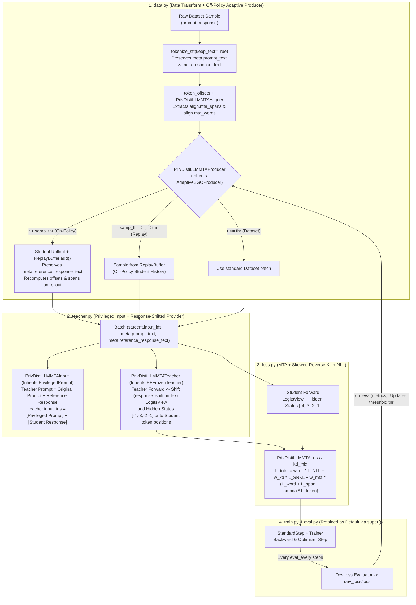

# Tutorial: Building a New Method with `lmkd init` — Combining MTA, DistiLLM Adaptive Off-Policy, and a Privileged Teacher

This tutorial provides an **end-to-end** guide for developing a new knowledge distillation (KD) method from scratch in **LM-KD** using the `lmkd init` scaffolding tool.

To illustrate how to override individual components while maximizing the reuse of framework defaults, we will build a composite method named **`priv_distillm_mta`** that combines three distinct techniques across three orthogonal design axes:

1. **Multi-granularity Text Alignment (`MTA`)** *(Axis D — Loss & Axis A — Span Alignment)*: Aligns multi-layer hidden representations between Student and Teacher across three granularities: **token-level** (attention-weighted cosine similarity), **word-level** (relational similarity between words in lower layers), and **span-level** (relational similarity between noun chunks and verb phrases in upper layers).
2. **DistiLLM's Off-Policy Adaptive Producer (`adaptive_sgo`)** *(Axis B — Data/Batch Producer)*: Dynamically adjusts a sampling threshold $\tau \in [0, 1]$ based on validation loss progression (`dev_loss/loss`), dynamically arbitrating at each training step between:
   - **On-policy rollout generation** from the live Student and caching into a `ReplayBuffer`,
   - **Off-policy replay sampling** from historical Student generations in `ReplayBuffer`,
   - **Off-policy ground-truth sampling** directly from the underlying dataset.
3. **Privileged Teacher with Prompt + Reference Response** *(Axis C — Teacher Input & Provider)*: Provides the Teacher with **privileged information** comprising both the original **`prompt`** and the ground-truth **`reference_response`** as an augmented prefix before scoring the Student's candidate response tokens, followed by position re-indexing (**response-shift**) for both **logits** and **multi-layer hidden states** to match the Student's token coordinates.

---

## Architecture Overview: Data Flow & Signal Routing



---

## Step 1: Scaffold the Method Boilerplate with `lmkd init`

Run the `lmkd init` CLI command to generate a self-contained baseline template for `priv_distillm_mta` in the `dev/` directory (or supply `--baseline` to target `src/baselines/` directly):

```bash
lmkd init priv_distillm_mta --domain same_tokenizer
```

This creates the following package directory structure:

```text
dev/priv_distillm_mta/
├── __init__.py          # Auto-imports and registers all plugins upon package load
├── config.py            # Centralized hyperparameter schema
├── loss.py              # Criterion (defaults to delegating to Criterion/TokenKD)
├── data.py              # Transform, Aligner, Producer (delegating to defaults via super())
├── teacher.py           # TeacherInputBuilder & TeacherProvider (delegating to defaults via super())
├── train.py             # Algorithm, StepStrategy, Callback, Trainer (delegating to defaults via super())
├── eval.py              # Evaluator (defaults to DevLoss)
├── recipe.yaml          # Executable training recipe
└── README.md            # Quick-reference guide for the baseline
```

In addition, `lmkd init` automatically creates:
- `tests/unit/test_priv_distillm_mta.py`: Pre-configured unit test validating registry builds and loss gradients.
- `recipes/same_tokenizer/priv_distillm_mta.yaml`: Centralized experiment recipe.

> [!TIP]
> **The `super()` fallback design in `lmkd init`:**
> Every file created inside `dev/priv_distillm_mta/` is pre-registered with the appropriate LM-KD Registry (`CRITERIONS`, `PRODUCERS`, `ALIGNERS`, `TEACHERS`, `TEACHER_INPUTS`, `STAGES`, `STEP_STRATEGIES`, `EVALUATORS`) and delegates unchanged execution to the framework's standard implementation via `super()`.
> For our composite method:
> - We only need to customize `config.py`, `data.py`, `teacher.py`, `loss.py`, and `recipe.yaml`.
> - `train.py` and `eval.py` **remain completely untouched** because the default `Standard` algorithm, `StandardStep`, and `DevLoss` evaluator already execute the canonical training loop and supply the `dev_loss/loss` metric required by DistiLLM's adaptive producer.

---

## Step 2: Define Hyperparameters in `config.py`

Open `dev/priv_distillm_mta/config.py` and declare the default hyperparameters for all three components (MTA, Adaptive SGO, and Privileged Prompting):

```python
"""Shared configuration schema for the ``priv_distillm_mta`` method."""

from __future__ import annotations

from typing import Literal

from lmkd.core.plugin import BaseConfig


class PrivDistiLLMMTAConfig(BaseConfig):
    """Centralized default hyperparameters for Privileged DistiLLM + MTA."""

    # --- 1. Skewed Reverse KL (DistiLLM) ---
    temperature: float = 1.0
    skew_alpha: float = 0.1
    srkl_weight: float = 1.0

    # --- 2. Multi-granularity Text Alignment (MTA) ---
    student_layers: list[int] = [-4, -3, -2, -1]
    teacher_layers: list[int] = [-4, -3, -2, -1]
    split_layer_mapping: list[int] = [0, 2, 4]
    w_span_loss: float = 1.0
    token_loss_weight: float = 0.1
    mode: Literal["auto", "same_tokenizer", "cross_tokenizer"] = "same_tokenizer"
    spacy_model: str = "en_core_web_sm"

    # --- 3. Off-Policy Adaptive Producer (DistiLLM) ---
    init_threshold: float = 0.0
    schedule: Literal["decreasing", "constant", "increasing"] = "decreasing"
    threshold_step: float = 0.1
    max_threshold: float = 1.0
    loss_eps: float = 0.1
    capacity: int = 1000

    # --- 4. Privileged Teacher Input ---
    privileged_template: str = (
        "### Instruction / Prompt\n"
        "{prompt_text}\n\n"
        "### Reference Solution (Privileged Teacher Information)\n"
        "{reference_response_text}\n\n"
        "### Response\n"
    )


__all__ = ["PrivDistiLLMMTAConfig"]
```

---

## Step 3: Implement `data.py` — Off-Policy Adaptive Producer + MTA Span Aligner

When integrating DistiLLM, MTA, and a Privileged Teacher, the data layer (`data.py`) handles **two critical responsibilities**:

1. **Semantic Span Extraction (`PrivDistiLLMMTAAligner`)**: Uses spaCy to parse noun chunks/verb phrases (`align.mta_spans`) and single words (`align.mta_words`) into character boundary intervals `[start_char, end_char)` for pooling hidden vectors in MTA.
2. **Preserving Ground-Truth References and Refreshing Spans on Rollouts (`PrivDistiLLMMTAProducer`)**:
   - Inherits directly from [`AdaptiveSGOProducer`](../../src/lmkd/data/producers.py) (which manages the decay schedule `sampling_threshold`, `ReplayBuffer`, and the `on_eval` callback that raises threshold $\tau$ when validation progress stalls).
   - Before executing `super().next(state)`, we preserve the ground-truth response under `meta.reference_response_text`. Consequently, **even when the Student generates an on-policy rollout response**, the Teacher still receives the reference solution as privileged context.
   - When a batch originates from on-policy generation (`producer/source == 1.0`) or replay where character offsets do not yet exist, the producer dynamically recomputes `student.offsets`, `align.mta_spans`, and `align.mta_words` matching the Student's actual rollout token sequence.

Update `dev/priv_distillm_mta/data.py`:

```python
"""Data pipeline overrides for ``priv_distillm_mta``.

Implements:
1. ``PrivDistiLLMMTATransform``: preserves original dataset response as ``meta.reference_response_text``.
2. ``PrivDistiLLMMTAAligner``: extracts word and phrase character spans (``align.mta_words``, ``align.mta_spans``).
3. ``PrivDistiLLMMTAProducer``: extends DistiLLM's ``AdaptiveSGOProducer`` (off-policy replay buffer +
   adaptive on-policy student rollout) and refreshes character offsets + MTA spans on generated rollouts
   while keeping ``meta.reference_response_text`` intact for the privileged teacher.
"""

from __future__ import annotations

from typing import Any

import torch

from baselines.mta.functional import extract_spans_and_words
from lmkd.core.batch import FIELDS, Batch, FieldSpec
from lmkd.core.plugin import BaseConfig
from lmkd.core.registry import ALIGNERS, PRODUCERS, TRANSFORMS
from lmkd.core.state import TrainState
from lmkd.data.aligners.base import Aligner
from lmkd.data.producers import AdaptiveSGOProducer
from lmkd.data.spans import ids_offsets
from lmkd.data.transforms.base import Transform

# Register batch fields for MTA and Privileged Teacher if not already registered
if "align.mta_spans" not in FIELDS:
    FIELDS.register(
        FieldSpec("align.mta_spans", "ragged", torch.long, 0, None, "[S, 2] char [start, end) offsets per span")
    )
if "align.mta_words" not in FIELDS:
    FIELDS.register(
        FieldSpec("align.mta_words", "ragged", torch.long, 0, None, "[W, 2] char [start, end) offsets per word")
    )
if "meta.reference_response_text" not in FIELDS:
    FIELDS.register(FieldSpec("meta.reference_response_text", "meta"))


@TRANSFORMS.register("priv_distillm_mta_transform")
class PrivDistiLLMMTATransform(Transform):
    """Duplicates ``meta.response_text`` into ``meta.reference_response_text`` so the
    Privileged Teacher always receives the ground-truth response even on Student rollouts.
    """

    requires = ("student.input_ids",)
    provides = ("meta.reference_response_text",)

    class Config(BaseConfig):
        pass

    def __call__(self, sample: dict[str, Any], ctx: Any) -> dict[str, Any] | None:
        ref_resp = sample.get("meta.reference_response_text") or sample.get("meta.response_text", "")
        sample["meta.reference_response_text"] = ref_resp
        return sample


@ALIGNERS.register("priv_distillm_mta_aligner")
class PrivDistiLLMMTAAligner(Aligner):
    """Extracts linguistic phrase spans (noun chunks / verb phrases) and word spans for MTA."""

    requires = ("student.input_ids",)
    provides = ("align.mta_spans", "align.mta_words")

    class Config(BaseConfig):
        spacy_model: str = "en_core_web_sm"

    def __init__(self, cfg: BaseConfig | None = None) -> None:
        super().__init__(cfg)
        self.nlp: Any = None

    def setup(self, rt: Any) -> None:
        try:
            import spacy

            self.nlp = spacy.load(self.cfg.spacy_model)
        except Exception:
            self.nlp = None

    def empty(self, sample: dict[str, Any]) -> dict[str, Any]:
        return {"align.mta_spans": [], "align.mta_words": []}

    def __call__(self, sample: dict[str, Any], ctx: Any) -> dict[str, Any]:
        text = sample.get("meta.response_text") or sample.get("meta.prompt_text", "")
        if not text:
            return self.empty(sample)

        spans_list, words_list = extract_spans_and_words([text], self.nlp)
        spans = [[s[0], s[1]] for s in spans_list[0]] if spans_list else []
        words = [[w[0], w[1]] for w in words_list[0]] if words_list else []
        return {"align.mta_spans": spans, "align.mta_words": words}


@PRODUCERS.register("priv_distillm_mta_producer")
class PrivDistiLLMMTAProducer(AdaptiveSGOProducer):
    """Combines DistiLLM's Adaptive SGO with dynamic offset/span regeneration for MTA.

    Algorithm inherited from ``AdaptiveSGOProducer``:
      1. Calculate step-dependent sampling threshold:
         ``samp_threshold = thr * (1 - step / total_steps)`` (with ``schedule: decreasing``).
      2. Draw random variable ``r ~ U(0, 1)``:
         - If ``r < samp_threshold`` or ``(r < thr and len(buffer) < capacity)``:
           Generate on-policy student rollout, push into ``ReplayBuffer``.
         - Elif ``r < thr``:
           Sample off-policy from ``ReplayBuffer``.
         - Else:
           Use standard off-policy dataset batch.
      3. On evaluation (``on_eval``), if ``dev_loss/loss >= prev_loss + loss_eps``,
         increment ``thr = min(thr + threshold_step, max_threshold)``.
    """

    class Config(AdaptiveSGOProducer.Config):
        init_threshold: float = 0.0
        schedule: str = "decreasing"
        threshold_step: float = 0.1
        max_threshold: float = 1.0
        loss_eps: float = 0.1
        capacity: int = 1000
        spacy_model: str = "en_core_web_sm"

    def setup(self, rt: Any) -> None:
        super().setup(rt)
        self._nlp: Any = None
        try:
            import spacy

            self._nlp = spacy.load(self.cfg.spacy_model)
        except Exception:
            self._nlp = None

    def _populate_rollout_offsets_and_spans(self, batch: Batch) -> Batch:
        """Recompute ``student.offsets``, ``align.mta_spans``, and ``align.mta_words`` on rollout batches."""
        # Ensure the reference response is preserved for the privileged teacher
        if "meta.reference_response_text" not in batch.meta and "meta.response_text" in batch.meta:
            batch.meta["meta.reference_response_text"] = list(batch.meta["meta.response_text"])

        if "student.offsets" in batch and "align.mta_spans" in batch and "align.mta_words" in batch:
            return batch

        tok = self.rt.student_tokenizer
        ids_t = batch["student.input_ids"]
        mask_t = batch["student.attention_mask"]
        plens = batch["student.prompt_len"].tolist() if "student.prompt_len" in batch else [0] * batch.batch_size
        B, T = ids_t.shape
        device = ids_t.device

        offsets_tensor = torch.zeros((B, T, 2), dtype=torch.long, device=device)
        rollout_texts: list[str] = []

        for b in range(B):
            seq_len = int(mask_t[b].sum().item())
            plen = int(plens[b])
            row_ids = ids_t[b, :seq_len].tolist()
            p_ids = row_ids[:plen]
            r_ids = row_ids[plen:]

            p_text = tok.decode(p_ids, skip_special_tokens=False, clean_up_tokenization_spaces=False)
            r_text = tok.decode(r_ids, skip_special_tokens=True, clean_up_tokenization_spaces=False)
            rollout_texts.append(r_text)

            p_off = ids_offsets(tok, p_ids)
            r_off = ids_offsets(tok, r_ids, len(p_text), skip_special_tokens=True)
            row_off = p_off + r_off
            for t_idx, (s_char, e_char) in enumerate(row_off[:seq_len]):
                offsets_tensor[b, t_idx, 0] = s_char
                offsets_tensor[b, t_idx, 1] = e_char

        batch["student.offsets"] = offsets_tensor
        batch.meta["meta.response_text"] = rollout_texts

        spans_list, words_list = extract_spans_and_words(rollout_texts, self._nlp)
        batch["align.mta_spans"] = [
            torch.tensor([[s[0], s[1]] for s in spans], dtype=torch.long, device=device)
            if spans
            else torch.zeros((0, 2), dtype=torch.long, device=device)
            for spans in spans_list
        ]
        batch["align.mta_words"] = [
            torch.tensor([[w[0], w[1]] for w in words], dtype=torch.long, device=device)
            if words
            else torch.zeros((0, 2), dtype=torch.long, device=device)
            for words in words_list
        ]
        return batch

    def next(self, state: TrainState) -> Batch:
        batch = super().next(state)
        return self._populate_rollout_offsets_and_spans(batch)


__all__ = [
    "PrivDistiLLMMTAAligner",
    "PrivDistiLLMMTAProducer",
    "PrivDistiLLMMTATransform",
]
```

---

## Step 4: Implement `teacher.py` — Privileged Teacher (Prompt + Reference Response)

Next, we customize how the Teacher constructs its input context and how its output signals are aligned:

1. **`PrivDistiLLMMTAInput` (Inherits `PrivilegedPrompt`)**:
   - Concatenates the original **`prompt_text`** and the ground-truth **`reference_response_text`** into a specialized privileged prompt.
   - Appends the Student's actual response tokens (`student_response_ids`) directly after this privileged prefix via `_collate_teacher_prompts_and_responses`.
   - The sequence layouts become:
     $$\text{Student Input} = [\underbrace{p_1, \dots, p_{L_S}}_{\text{prompt\_len } = L_S}, \; r_1, \dots, r_M]$$
     $$\text{Teacher Input} = [\underbrace{q_1, \dots, q_{L_T}}_{\text{privileged prompt\_len } = L_T \gg L_S}, \; r_1, \dots, r_M]$$

2. **`PrivDistiLLMMTATeacher` (Inherits `HFFrozenTeacher`)**:
   - In standard `HFFrozenTeacher` with `position_map: response_shift`, only `out.logits` (`LogitsView`) is shifted onto Student positions, while `out.side` (holding intermediate `hidden_states`) remains in Teacher sequence length $L_T + M$.
   - Because **MTA** directly computes similarity between `teacher.side.hidden(layer)` and `student.hidden(layer)` (which has sequence length $L_S + M$), we override `signals()` to apply [`response_shift_index`](../../src/lmkd/teachers/signals.py) + [`gather_positions`](../../src/lmkd/teachers/signals.py) to **all captured hidden layers (`_captured` and `last_hidden_state`)**!
   - On response token positions $t \ge L_S$, the corresponding index in the Teacher is $t - L_S + L_T$, guaranteeing an exact **1-to-1 alignment** between the Student's response token $r_k$ and the Teacher's contextualized representation of $r_k$.

Update `dev/priv_distillm_mta/teacher.py`:

```python
"""Teacher overrides for ``priv_distillm_mta``.

1. ``PrivDistiLLMMTAInput``: Prepends a privileged prompt containing BOTH the original
   ``prompt_text`` and the ground-truth ``reference_response_text`` before the student's
   response tokens.
2. ``PrivDistiLLMMTATeacher``: Runs the frozen teacher on ``teacher.*`` inputs and shifts
   BOTH ``LogitsView`` (for SRKL token KD) and multi-layer hidden states ``SideOutput``
   (for MTA word/span/token alignment) onto the student's token positions via ``response_shift_index``.
"""

from __future__ import annotations

from typing import Any

from lmkd.core.batch import Batch
from lmkd.core.registry import TEACHER_INPUTS, TEACHERS
from lmkd.models.forward import SideOutput, SideRequest
from lmkd.teachers.input_builders import PrivilegedPrompt
from lmkd.teachers.providers import HFFrozenTeacher
from lmkd.teachers.signals import (
    TeacherOutput,
    TeacherSignalSpec,
    gather_positions,
    response_shift_index,
)


@TEACHER_INPUTS.register("priv_distillm_mta_input")
class PrivDistiLLMMTAInput(PrivilegedPrompt):
    """Supplies both the original prompt and reference response as privileged context for the Teacher."""

    class Config(PrivilegedPrompt.Config):
        template: str = (
            "### Instruction / Prompt\n"
            "{prompt_text}\n\n"
            "### Reference Solution (Privileged Information)\n"
            "{reference_response_text}\n\n"
            "### Response to Evaluate\n"
        )
        fields: list[str] = ["prompt_text", "reference_response_text"]
        use_chat_template: bool = True
        max_prompt_len: int = 4096
        truncation_side: str = "left"
        tokenizer: str = "student"

    def build(self, batch: Batch, rt: Any) -> Batch:
        # Fall back to meta.response_text if meta.reference_response_text is absent
        if "meta.reference_response_text" not in batch.meta and "meta.response_text" in batch.meta:
            batch.meta["meta.reference_response_text"] = list(batch.meta["meta.response_text"])
        if "meta.prompt_text" not in batch.meta:
            batch.meta["meta.prompt_text"] = [""] * batch.batch_size
        return super().build(batch, rt)


@TEACHERS.register("priv_distillm_mta_teacher")
class PrivDistiLLMMTATeacher(HFFrozenTeacher):
    """Frozen HF Teacher supporting ``response_shift`` for both Logits and Multi-layer Hidden States.

    When the Teacher has a longer privileged prefix (``teacher.prompt_len != student.prompt_len``):
      - ``super().signals(...)`` re-indexes ``out.logits`` (``LogitsView``) onto Student coordinates.
      - This subclass further shifts all captured hidden layers in ``out.side`` onto Student coordinates
         and harmonizes ``teacher.attention_mask`` / ``teacher.offsets`` for MTA span alignment.
    """

    class Config(HFFrozenTeacher.Config):
        position_map: str = "response_shift"

    def signals(
        self,
        batch: Batch,
        spec: TeacherSignalSpec | None,
        req: SideRequest | None,
        student: SideOutput | None,
    ) -> TeacherOutput | None:
        out = super().signals(batch, spec, req, student)
        if out is None or out.side is None:
            return out

        side = "teacher" if "teacher.input_ids" in batch else "student"
        if self.cfg.position_map == "response_shift" and side == "teacher":
            t_len = out.side.last_hidden.shape[1]
            idx, valid = response_shift_index(batch, t_len)

            # 1. Shift captured intermediate hidden layers (e.g., [-4, -3, -2, -1]) to Student coordinates
            for layer_idx, h_tensor in list(out.side._captured.items()):
                out.side._captured[layer_idx] = gather_positions(h_tensor, idx)

            # 2. Shift last_hidden_state if accessed directly
            if hasattr(out.side._out, "last_hidden_state") and out.side._out.last_hidden_state is not None:
                out.side._out.last_hidden_state = gather_positions(out.side._out.last_hidden_state, idx)

            # 3. Synchronize Teacher attention mask and token offsets to match shifted Student positions
            s_mask = batch["student.attention_mask"]
            shifted_mask = (s_mask.bool() & valid.to(s_mask.device)).long()
            out.side.attention_mask = shifted_mask
            batch["teacher.attention_mask"] = shifted_mask
            if "student.offsets" in batch:
                batch["teacher.offsets"] = batch["student.offsets"]

        return out


__all__ = [
    "PrivDistiLLMMTAInput",
    "PrivDistiLLMMTATeacher",
]
```

---

## Step 5: Implement `loss.py` — Combining MTA + Skewed Reverse KL (SRKL)

In `dev/priv_distillm_mta/loss.py`, we inherit directly from `MTA` and integrate DistiLLM's **Skewed Reverse KL (`srkl`)** within the same Criterion:

Combining both into `PrivDistiLLMMTALoss` offers two major advantages:
1. It presents a clean, unified interface that can be plugged in standalone or combined with standard cross-entropy (`nll`) via `kd_mix`.
2. The `features()` method simultaneously requests `logits="view"` (for memory-efficient chunked SRKL) and `hidden=tuple(student_layers)` (for MTA), allowing `ForwardRunner` to execute **exactly one forward pass** for the Student and **one forward pass** for the Teacher.

The composite loss function is formulated as:
$$\mathcal{L}_{\text{Priv-DistiLLM-MTA}} = w_{\text{srkl}} \cdot \mathrm{KL}\!\left(p_S \,\|\, \alpha p_T + (1-\alpha) p_S\right) + w_{\text{span}} \cdot \frac{1}{|\mathcal{L}|} \sum_{l \in \mathcal{L}} \left(\mathcal{L}_{\text{rel}}^{(l)} + \lambda_{\text{tok}} \mathcal{L}_{\text{cos}}^{(l)}\right)$$

Update `dev/priv_distillm_mta/loss.py`:

```python
"""Loss / Criterion implementation for ``priv_distillm_mta``.

Combines:
1. Multi-granularity Text Alignment (MTA) across multiple student/teacher hidden layers
   (word-level relational loss on lower layers, phrase-span relational loss on upper layers,
   plus attention-weighted token cosine loss).
2. DistiLLM's Skewed Reverse KL (SRKL) on target-aligned response logits via chunked ``LogitsView``.
"""

from __future__ import annotations

from typing import Literal

import torch

from baselines.mta.loss import MTA
from lmkd.core.registry import CRITERIONS
from lmkd.losses.base import LossContext, LossOutput, LossTerm
from lmkd.losses.functional.divergences import get_divergence
from lmkd.models.forward import FeatureRequest, SideRequest
from lmkd.models.logits_view import chunked_token_divergence
from lmkd.teachers.signals import TeacherSignalSpec


@CRITERIONS.register("priv_distillm_mta_loss")
class PrivDistiLLMMTALoss(MTA):
    """Unified Criterion combining Multi-granularity Text Alignment (MTA) + DistiLLM SRKL.

    Inherits layer projection modules (``LinearProjector`` via ``build_modules``) and
    layer-pair computations (``_compute_layer_pair_loss``) from ``MTA``, while augmenting
    with streaming Skewed Reverse KL on position-shifted teacher logits.
    """

    needs_teacher = True
    supports_packing = False

    class Config(MTA.Config):
        # MTA hyperparameters (inherited from MTA.Config)
        student_layers: list[int] = [-4, -3, -2, -1]
        teacher_layers: list[int] = [-4, -3, -2, -1]
        split_layer_mapping: list[int] | None = [0, 2, 4]
        w_span_loss: float = 1.0
        token_loss_weight: float = 0.1
        mode: Literal["auto", "same_tokenizer", "cross_tokenizer"] = "same_tokenizer"
        spacy_model: str = "en_core_web_sm"

        # Skewed Reverse KL hyperparameters (DistiLLM)
        srkl_weight: float = 1.0
        skew_alpha: float = 0.1
        temperature: float = 1.0

    def features(self) -> FeatureRequest:
        # Request both multi-layer hidden states (for MTA) and logits view (for SRKL) in a single pass
        need_logits: Literal["none", "view"] = "view" if self.cfg.srkl_weight > 0 else "none"
        sig_kind: Literal["full", "hidden"] = "full" if self.cfg.srkl_weight > 0 else "hidden"
        return FeatureRequest(
            student=SideRequest(
                logits=need_logits,
                hidden=tuple(self.cfg.student_layers),
            ),
            teacher=SideRequest(
                logits=need_logits,
                hidden=tuple(self.cfg.teacher_layers),
            ),
            teacher_signal=TeacherSignalSpec(kind=sig_kind),
        )

    def forward(self, ctx: LossContext) -> LossOutput:
        # 1. Execute super().forward(ctx) for multi-layer MTA alignment (word + span + token cosine)
        mta_out = super().forward(ctx)
        terms = dict(mta_out.terms)
        metrics = dict(mta_out.metrics)

        # 2. Compute Skewed Reverse KL (SRKL) over response tokens (labels != -100)
        if self.cfg.srkl_weight > 0:
            if ctx.student.logits is None or ctx.teacher is None or ctx.teacher.logits is None:
                raise ValueError("PrivDistiLLMMTALoss with srkl_weight > 0 requires student & teacher logits")

            t = self.cfg.temperature
            s_view = ctx.student.logits.with_temperature(t)
            t_view = ctx.teacher.logits.with_temperature(t)
            div_fn = get_divergence("srkl", alpha=self.cfg.skew_alpha)

            # Evaluate divergences chunk-by-chunk across the sequence dimension without materializing [B, T, V]
            mask = ctx.supervised_mask("student")
            per_tok = chunked_token_divergence(s_view, t_view, div_fn, mask=mask, chunk_size=1024) * (t * t)
            srkl_sum = per_tok.sum()

            terms["srkl"] = LossTerm(self.cfg.srkl_weight * srkl_sum, "token_sum")
            metrics["srkl_tok"] = (srkl_sum.detach() / mask.sum().clamp_min(1.0))

        return LossOutput(terms=terms, metrics=metrics)


__all__ = ["PrivDistiLLMMTALoss"]
```

---

## Step 6: Retain Default `train.py` and `eval.py` via `super()`

Inspect the generated `dev/priv_distillm_mta/train.py` and `dev/priv_distillm_mta/eval.py`:

- **`train.py`**:
  - `PrivDistiLLMMTAAlgorithm(Standard)` and `PrivDistiLLMMTAStep(StandardStep)` delegate directly to `super()`.
  - In `Trainer`'s execution loop, every `eval_every` step triggers active evaluators and invokes `self.rt.producer.on_eval(eval_metrics)` — automatically activating threshold updates in `PrivDistiLLMMTAProducer` without writing any custom training loop logic!
- **`eval.py`**:
  - `PrivDistiLLMMTAEvaluator(DevLoss)` inherits from `DevLoss`. When configured with `name_prefix: dev_loss` in the recipe, it emits `"dev_loss/loss"`, which `PrivDistiLLMMTAProducer.on_eval` listens to for adapting its on-policy/replay sampling threshold.

**No code modifications are required** in either `train.py` or `eval.py`.

---

## Step 7: Configure the Complete `recipe.yaml`

Edit `dev/priv_distillm_mta/recipe.yaml` to wire together all components:

```yaml
name: priv_distillm_mta

# Automatically load plugins from dev/priv_distillm_mta
imports:
  - dev/priv_distillm_mta/__init__.py

models:
  student:
    path: Qwen/Qwen2.5-0.5B
    dtype: bf16
  teacher:
    path: Qwen/Qwen2.5-1.5B
    dtype: bf16

data:
  train:
    type: jsonl
    path: data/dolly/train.jsonl
  eval:
    type: jsonl
    path: data/dolly/val.jsonl
  max_length: 512
  transforms:
    # 1. Tokenize SFT data while preserving raw text (meta.prompt_text, meta.response_text)
    - type: tokenize_sft
      teacher: false
      keep_text: true
    # 2. Duplicate reference response into meta.reference_response_text for Privileged Teacher
    - type: priv_distillm_mta_transform
    # 3. Compute character offsets for student tokens
    - type: token_offsets
      teacher: false
    # 4. Extract linguistic phrase and word spans (align.mta_spans, align.mta_words)
    - type: align
      aligners:
        - type: priv_distillm_mta_aligner
          spacy_model: en_core_web_sm

producer:
  type: priv_distillm_mta_producer
  init_threshold: 0.0
  schedule: decreasing
  threshold_step: 0.1
  max_threshold: 1.0
  loss_eps: 0.1
  capacity: 1000
  sampling:
    temperature: 1.0
    top_p: 1.0
    max_new_tokens: 256

rollout:
  type: hf

teacher:
  # Teacher operates on [Privileged Prompt (Prompt + Reference Response)] + [Student Response]
  # and shifts both LogitsView and Hidden States [-4, -3, -2, -1] onto Student token positions
  provider:
    type: priv_distillm_mta_teacher
    position_map: response_shift
  input:
    type: priv_distillm_mta_input
    use_chat_template: true
    fields: [prompt_text, reference_response_text]
    template: |
      ### Instruction / Prompt
      {prompt_text}

      ### Reference Solution (Privileged Information)
      {reference_response_text}

      ### Response to Evaluate

algorithm:
  type: priv_distillm_mta_algorithm

step:
  type: priv_distillm_mta_step

loss:
  aggregator:
    type: kd_mix
    kd_ratio: 0.5
    ce_alias: nll
  terms:
    - criterion: nll
      weight: 1.0
    - criterion: priv_distillm_mta_loss
      weight: 1.0
      params:
        # Skewed Reverse KL parameters (DistiLLM)
        srkl_weight: 1.0
        skew_alpha: 0.1
        temperature: 1.0
        # Multi-granularity Text Alignment parameters (MTA)
        student_layers: [-4, -3, -2, -1]
        teacher_layers: [-4, -3, -2, -1]
        split_layer_mapping: [0, 2, 4]
        w_span_loss: 1.0
        token_loss_weight: 0.1
        mode: same_tokenizer

optim:
  lr: 2.0e-5
  weight_decay: 0.0

train:
  epochs: 3
  batch_size: 16
  micro_batch_size: 4
  eval_every: 200
  save_every: 500
  output_dir: outputs/priv_distillm_mta

eval:
  - type: priv_distillm_mta_eval
    name_prefix: dev_loss
  - type: rouge
    max_samples: 256
    sampling:
      temperature: 0.0
      max_new_tokens: 256
```

---

## Step 8: Testing, Verification, and Training

### 1. Isolated Criterion Smoke Testing (`lmkd try`)

Verify that `priv_distillm_mta_loss` executes both forward and backward passes across `LinearProjector` and `student_logits` using synthetic inputs:

```bash
PYTHONPATH=src:. lmkd try priv_distillm_mta_loss \
  --plugins dev/priv_distillm_mta/__init__.py
```

### 2. Run the Scaffolded Unit Tests

The test suite generated by `lmkd init` at `tests/unit/test_priv_distillm_mta.py` automatically checks plugin registration and backward pass differentiability:

```bash
PYTHONPATH=src:. pytest tests/unit/test_priv_distillm_mta.py -q
```

### 3. Verify Recipe Compatibility (`lmkd check`)

Validate dependency alignment across `transforms` $\rightarrow$ `producer` $\rightarrow$ `teacher.input` $\rightarrow$ `teacher.provider` $\rightarrow$ `loss`:

```bash
# Static configuration and schema validation
PYTHONPATH=src:. lmkd check -c dev/priv_distillm_mta/recipe.yaml

# Preflight check executing a live forward/backward iteration
PYTHONPATH=src:. lmkd check -c dev/priv_distillm_mta/recipe.yaml --preflight
```

### 4. Execute Training and Evaluation

```bash
# Launch training run
PYTHONPATH=src:. lmkd train -c dev/priv_distillm_mta/recipe.yaml

# Evaluate the final trained checkpoint
PYTHONPATH=src:. lmkd eval -c dev/priv_distillm_mta/recipe.yaml --ckpt outputs/priv_distillm_mta/final
```

---

## Summary: When to Modify Which File

| Generated File | Default Behavior | Customization in `priv_distillm_mta` |
| :--- | :--- | :--- |
| `config.py` | Basic hyperparameter defaults (`temperature`, `alpha`) | Extended with MTA layer indices, Adaptive SGO thresholds, and Privileged Prompt template |
| `data.py` | Delegates to `Transform`, `ExactTokenAligner`, `DatasetProducer` | Overridden with `PrivDistiLLMMTAProducer(AdaptiveSGOProducer)` and `PrivDistiLLMMTAAligner` for adaptive rollout generation, MTA span parsing, and reference retention |
| `teacher.py` | Delegates to `SameInput` and `HFFrozenTeacher` | Overridden with `PrivDistiLLMMTAInput(PrivilegedPrompt)` and `PrivDistiLLMMTATeacher(HFFrozenTeacher)` to shift both hidden states and logits onto Student positions |
| `loss.py` | Delegates to `TokenKD` (Forward KL) | Overridden with `PrivDistiLLMMTALoss(MTA)` combining multi-layer MTA alignment and Skewed Reverse KL (`srkl`) |
| `train.py` | Delegates to `Standard`, `StandardStep`, `Trainer` | **Retained as default** (`PrivDistiLLMMTAAlgorithm`, `PrivDistiLLMMTAStep`) |
| `eval.py` | Delegates to `DevLoss` (`dev_loss/loss`) | **Retained as default** (automatically emits validation loss for `AdaptiveSGOProducer.on_eval`) |
