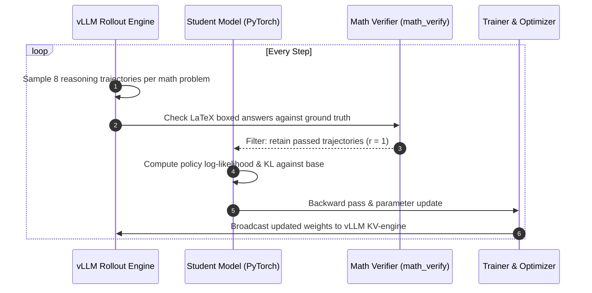

# Tutorial: On-Policy Reasoning Self-Distillation

This tutorial demonstrates how to run an **on-policy self-distillation loop (OPSD)** where a student language model ([`Qwen/Qwen2.5-Math-1.5B`](https://huggingface.co/Qwen/Qwen2.5-Math-1.5B)) bootstraps its mathematical reasoning without an external teacher model.

---

## 1. The On-Policy Loop Concept



---

## 2. Recipe Configuration

Create `recipes/self_distill/quick_opsd.yaml`:

```yaml
_base_:
  - ../_base_/engine_zero2.yaml

models:
  student:
    path: Qwen/Qwen2.5-Math-1.5B
    dtype: bf16
    task: causal_lm

producer:
  type: rollout_group
  n: 8
  sampling:
    temperature: 0.7
    max_new_tokens: 1024
  verifier: math_verify

rollout:
  type: vllm_colocate
  gpu_memory_utilization: 0.40

teacher:
  provider: none
  input: same

algorithm:
  type: rl

step:
  type: ppo_epochs
  epochs: 1
  mini_batches: 1

loss:
  aggregator: weighted_sum
  terms:
    - criterion: ppo_clip
      alias: opsd
      params:
        clip_low: 0.2
        clip_high: 0.2

data:
  train:
    type: hf_dataset
    path: openai/gsm8k
    name: main
    split: train
  transforms:
    - type: tokenize_prompt
      template: 'Problem: {question}\n\nPlease reason step by step, and put your final answer within \boxed{}.'
  max_length: 2048

optim:
  lr: 1.0e-5
  optimizers:
    default:
      type: adamw

train:
  max_steps: 500
  batch_size: 16
  micro_batch_size: 1
  output_dir: ./outputs/opsd_math_bootstrapping
```

---

## 3. Running Training

Start the self-distillation process:

```bash
lmkd train -c recipes/self_distill/quick_opsd.yaml
```

The terminal log will output the real-time rollout verification success rate (`pass@8`) and self-imitation loss:
```text
[Step 50/500] Rollout Pass@8: 42.5% | Passed Paths: 136 | Loss SFT: 0.841 | Loss KL: 0.012
[Step 100/500] Rollout Pass@8: 51.2% | Passed Paths: 164 | Loss SFT: 0.695 | Loss KL: 0.018
[Step 250/500] Rollout Pass@8: 64.8% | Passed Paths: 207 | Loss SFT: 0.512 | Loss KL: 0.024
[Step 500/500] Rollout Pass@8: 72.3% | Passed Paths: 231 | Loss SFT: 0.410 | Loss KL: 0.031
✓ Monotonic reasoning accuracy gain achieved without external supervision!
```

